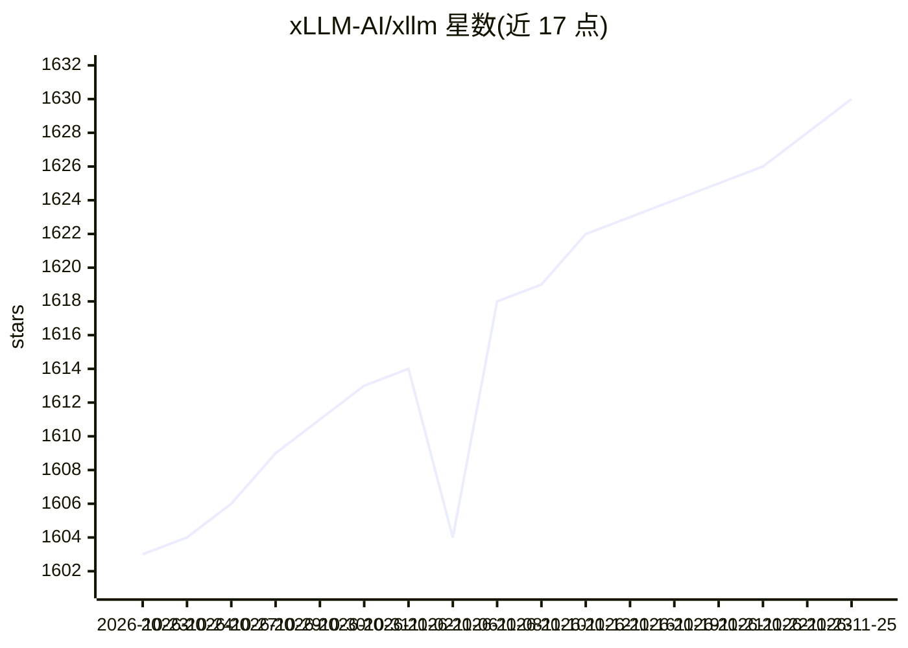

# xLLM-AI/xllm

⭐ 1,630 · C++ · Apache-2.0 · 推送 2026-11-23 · [GitHub](https://github.com/xLLM-AI/xllm) · [官网](https://xllm-ai.com/) · 组织维护 · 中文 README

**面向国产AI加速器的企业级LLM/VLM/DiT推理引擎**

xLLM 是一个推理框架，针对国产 AI 加速器专门优化，定位企业级部署场景。采用服务-引擎解耦架构：服务层负责调度与可用性，引擎层负责计算。基于 Mooncake 构建混合 KV cache 管理，支持全局缓存管理与智能卸载、预取。曾在京东核心零售业务中规模化运行。托管于开放原子开源基金会，并发布过 arXiv 技术报告。安装方式通过 Docker 或文档中的 Quick Start 进行。

## 筛选速览

| 维度 | 判定 | 备注 |
|---|---|---|
| AI 角色 | `ai-ecosystem` | LLM/agent 周边工具 |
| 许可风险 | `permissive` | Apache-2.0 |
| 部署形态 | `None` |  |
| 模型依赖 | locked-api |  |
| 硬件要求 | — | 无带数字的原话,不猜 |
| 安装摩擦 | `low` | 无编译、无系统依赖或容器化 |
| 成熟度 | — | 结构信号不足 |

## 能力要点

- 支持 LLM、VLM 与 DiT 模型的推理
- 服务-引擎解耦架构（服务层调度、引擎层计算）
- 基于 Mooncake 的混合 KV cache 全局管理与卸载/预取
- 支持 Ascend NPU、寒武纪 MLU、摩尔线程、海光 DCU 等多种国产硬件

## 适用场景

- 在国产加速器硬件上部署大模型推理服务
- 企业内部大规模在线/离线推理业务
- 新模型发布后需 day-0 接入推理的团队

## 场景标签

`推理引擎` · 领域:训练与推理

## 证据(README 行号)

> L26: **xLLM** is an **efficient LLM inference framework**, specifically optimized for **Chinese AI accelerators**, enabl
> L34: * **Service-Engine Decoupled Architecture**: Service layer handles scheduling and availability; engine layer handle
> L33: * **Mainstream Hardware Support**: Purpose-built and deeply optimized for Chinese AI accelerators.

## 星数曲线

2026-10-23 1,603 → 2026-11-25 1,630（+27）

---
*卡片 v1 · prompt 1.4 · 生成 2026-11-23 · 置信度 high · 依据 README sha `e70b55058586` · [字段定义](../../DATASET.md)*
