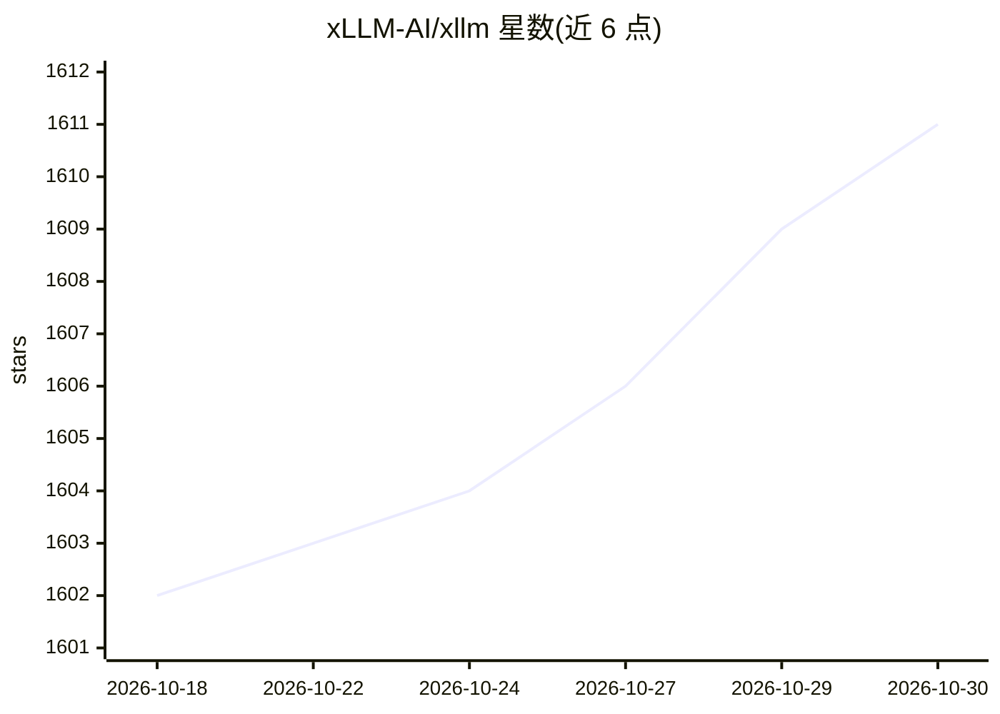

# xLLM-AI/xllm

⭐ 1,611 · C++ · Apache-2.0 · 推送 2026-10-29 · [GitHub](https://github.com/xLLM-AI/xllm) · [官网](https://xllm-ai.com/) · 组织维护 · 中文 README

**面向国产 AI 加速器优化的 LLM/VLM/DiT/REC 推理引擎**

由京东团队开发、捐赠给开放原子开源基金会的高性能推理框架，服务 LLM、VLM、DiT 与推荐模型推理，针对昇腾 NPU、寒武纪 MLU、摩尔线程 GPU、海光 DCU、MetaX、天数智芯等国产加速器深度优化。采用服务层与引擎层解耦架构：服务层负责调度与可用性，引擎层负责计算；基于 Mooncake 构建混合 KV cache 管理，支持全局 KV cache 的智能卸载与预取。已在京东零售核心业务规模化部署，day-0 支持 GLM、DeepSeek、MiniMax 等系列模型。安装与启动方式见外部文档链接，README 未直接给出命令。

## 筛选速览

| 维度 | 判定 | 备注 |
|---|---|---|
| AI 角色 | `ai-ecosystem` | LLM/agent 周边工具 |
| 许可风险 | `permissive` | Apache-2.0 |
| 部署形态 | `None` |  |
| 模型依赖 | locked-api |  |
| 硬件要求 | — | 无带数字的原话,不猜 |
| 安装摩擦 | `low` | 无编译、无系统依赖或容器化 |
| 成熟度 | — | 结构信号不足 |

## 能力要点

- 针对 6 类国产 AI 加速器（昇腾/寒武纪/摩尔线程/海光/MetaX/天数智芯）优化
- 服务-引擎解耦架构，服务层调度、引擎层计算
- 基于 Mooncake 的混合 KV cache 管理，支持智能卸载与预取
- day-0 支持 GLM-5.3-Flash、DeepSeek-V4、MiniMax-M3 等新模型

## 适用场景

- 在国产 AI 加速器上部署 LLM/VLM 推理服务
- 企业级规模化推理部署（已应用于京东零售核心业务）
- 新模型发布当日即可部署推理

## 场景标签

`推理引擎` · 领域:训练与推理

## 证据(README 行号)

> L26: **xLLM** is an **efficient LLM inference framework**, specifically optimized for **Chinese AI accelerators**, enabl
> L33: * **Mainstream Hardware Support**: Purpose-built and deeply optimized for Chinese AI accelerators.

## 星数曲线

2026-10-18 1,602 → 2026-10-30 1,611（+9）

---
*卡片 v1 · prompt 1.4 · 生成 2026-10-21 · 置信度 high · 依据 README sha `b201d75b2323` · [字段定义](../../DATASET.md)*
