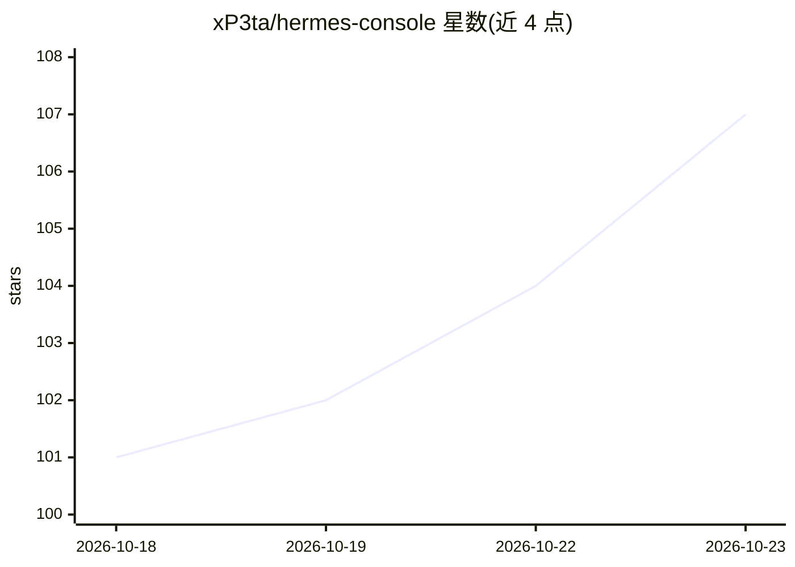

# xP3ta/hermes-console

⭐ 107 · Dart · GPL-3.0 · 推送 2026-10-21 · [GitHub](https://github.com/xP3ta/hermes-console) · [官网](https://hermes.xpetalab.dev) · 个人维护

**连接自托管 Hermes Agent 的原生 Android 客户端**

面向自建 Hermes Agent 用户的 Android 原生应用（Flutter/Dart，GPL-3.0）：通过与 Hermes 自带的 Dashboard 直连，无需 Console 账号或中转服务器；电脑端执行一条安装脚本后扫码即可连接，也支持手动填地址。功能含展示推理/工具/任务的对话聊天、聊天内语音、Bots 与房间、Cron 定时任务与任务看板、模型管理与 SSH 终端/SFTP。凭据存于 Android Keystore，无遥测，支持 Tailscale 远程访问。由个人独立开发，与 Nous Research 无关联。

## 筛选速览

| 维度 | 判定 | 备注 |
|---|---|---|
| AI 角色 | `ai-ecosystem` | LLM/agent 周边工具 |
| 许可风险 | `viral` | GPL-3.0 |
| 部署形态 | `None` |  |
| 模型依赖 | — | README 未给出锁定关系 |
| 硬件要求 | — | 无带数字的原话,不猜 |
| 安装摩擦 | `low` | 无编译、无系统依赖或容器化 |
| 成熟度 | — | 结构信号不足 |

## 能力要点

- 对话中展示 agent 的推理、工具调用与任务过程
- 一条命令 + 扫码连接自托管 Dashboard，无账号无遥测
- 内置 Cron 任务、任务看板、模型管理与 SSH 终端/SFTP
- 凭据存于 Android Keystore，支持 Tailscale 私网外访问

## 适用场景

- 在手机上与自己部署的 Hermes Agent 对话和查看其工作过程
- 管理 Hermes 的多个 Bot 身份、房间与定时任务
- 通过手机 SSH 远程操作运行 Hermes 的服务器

## 场景标签

 · 领域:移动应用/自托管 AI 客户端

## 证据(README 行号)

> L19: Console is an independent Android app for Hermes Agent, the agent you run on your own computer or server. It talks 
> L23: Console talks to the **Dashboard** that comes with Hermes. You do not need a pairing code, the Gateway or an API ke

## 星数曲线

2026-10-18 101 → 2026-10-23 107（+6）

---
*卡片 v1 · prompt 1.4 · 生成 2026-10-23 · 置信度 high · 依据 README sha `fab26312e40b` · [字段定义](../../DATASET.md)*
