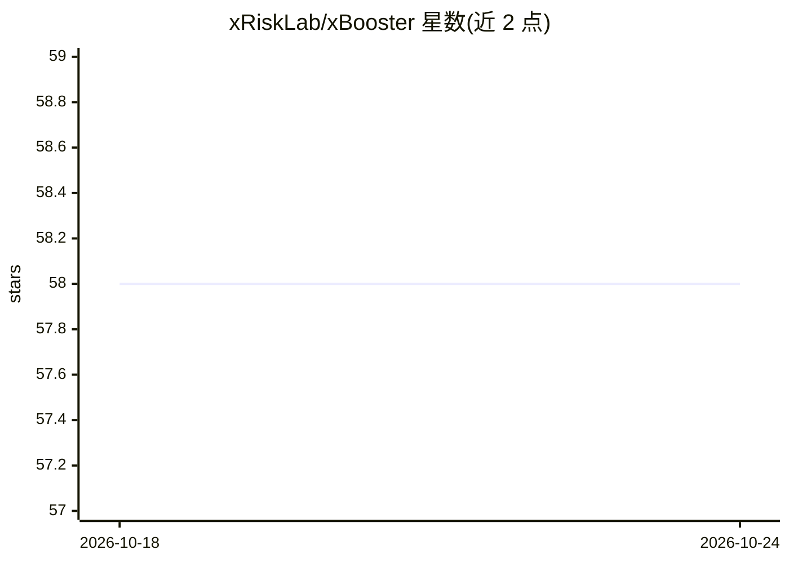

# xRiskLab/xBooster

⭐ 58 · Python · MIT · 推送 2026-04-19 · [GitHub](https://github.com/xRiskLab/xBooster) · 组织维护

**把 XGBoost/LightGBM/CatBoost 转成可解释信用评分卡的 Python 库**

面向信用评分场景的 Python 库：读取梯度提升树分类模型（XGBoost、LightGBM、CatBoost），将其转换为对数（积分式）评分卡，并提供解释性工具套件——分裂节点的 WOE/IV 统计、树可视化、全局与局部特征重要性、无需外部 shap 包的原生 SHAP 积分。支持生成 SQL 部署查询（CatBoost 除外）、增量微调辅助函数、区间评分卡与类别特征预处理器。CatBoost 支持为实验性且功能受限。

## 筛选速览

| 维度 | 判定 | 备注 |
|---|---|---|
| AI 角色 | `ai-ecosystem` | LLM/agent 周边工具 |
| 许可风险 | `permissive` | MIT |
| 部署形态 | `library` | 以包/库形式分发 |
| 模型依赖 | — | README 未给出锁定关系 |
| 硬件要求 | — | 无带数字的原话,不猜 |
| 安装摩擦 | `low` | 无编译、无系统依赖或容器化 |
| 成熟度 | `idea` | |

## 能力要点

- 三种 GBDT 库的评分卡构造（PDO 积分换算）
- 原生 SHAP 积分，无需外部 shap 包，支持 intercept 分布（SAS 风格）
- SQL 查询生成用于评分卡生产部署
- 微调辅助：冻结基础树追加新树或热启动扩展特征

## 适用场景

- 信贷风控中把梯度提升模型落成可解释评分卡
- 对已上线模型做 WOE/IV 与特征重要性解释
- 生成 SQL 形式的评分卡用于生产系统部署

## 场景标签

 · 领域:金融风控/机器学习工具

## 证据(README 行号)

> L12: A scorecard framework for credit scoring tasks with gradient-boosted decision trees (XGBoost, LightGBM, and CatBoos
> L15: In addition, it provides a suite of interpretability tools to understand the model's behavior.
> L24: xbooster also provides a scorecard deployment using SQL 📦.

## 星数曲线

2026-10-18 58 → 2026-10-24 58（+0）

---
*卡片 v1 · prompt 1.4 · 生成 2026-10-24 · 置信度 high · 依据 README sha `2f7f8985652f` · [字段定义](../../DATASET.md)*
