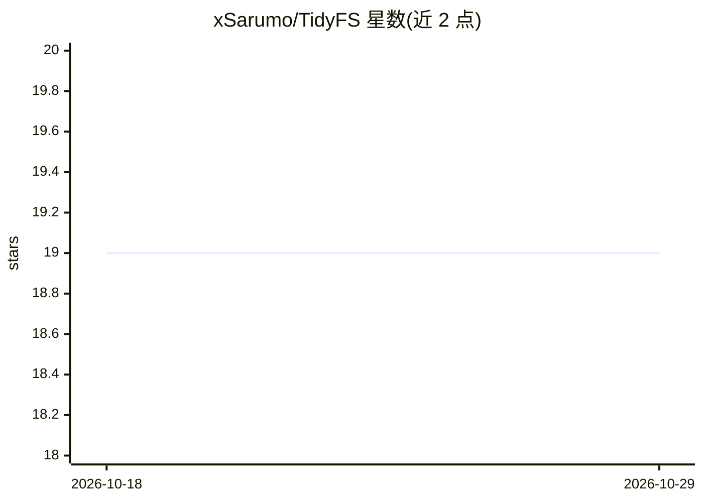

# xSarumo/TidyFS

⭐ 19 · Go · MIT · 推送 2026-06-27 · [GitHub](https://github.com/xSarumo/TidyFS) · 个人维护

**Linux 终端文件整理工具：按内容与文件名分类整理文档**

面向 Linux 用户的终端（TUI）文件整理工具：扫描源文件夹中的 .pdf/.txt/.doc/.docx/.md 文档，提取文本预览，按文件名与内容分类到 Career/Education/Finance 等类目，再以三种模式整理——FUSE 虚拟目录树（不动原文件）、copy 或 move。分类有两种模式：TF-IDF+逻辑回归的本地经典 ML 快速分类器，或基于本地 Ollama（默认 qwen3:1.7b）的 LLM 分类器。Go 负责 TUI 与文件系统操作，Python 负责文本提取与分类。需从源码构建（make），FUSE 模式依赖 fuse3。

## 筛选速览

| 维度 | 判定 | 备注 |
|---|---|---|
| AI 角色 | `ai-enhanced` | 去掉 AI 部分产品仍成立 |
| 许可风险 | `permissive` | MIT |
| 部署形态 | `None` |  |
| 模型依赖 | local-ok | 支持本地模型 |
| 硬件要求 | — | 无带数字的原话,不猜 |
| 安装摩擦 | `low` | 无编译、无系统依赖或容器化 |
| 成熟度 | — | 结构信号不足 |

## 能力要点

- TF-IDF+LogisticRegression 快速分类与本地 Ollama LLM 分类两种模式
- fuse/copy/move 三种整理模式，fuse 模式不移动原文件
- 支持 .pdf/.txt/.doc/.docx/.md，含 PDF/DOCX 文本预览提取
- 清理操作保护根目录、home 目录与冲突路径

## 适用场景

- 整理 Downloads 等杂乱文件夹中的文档并按类目归档
- 先用 fuse 虚拟目录预览分类结果再决定是否移动文件
- 在本地无 Ollama 时用 TF-IDF 模式离线快速分类

## 场景标签

 · 领域:桌面实用工具/文件管理

## 证据(README 行号)

> L13: **TidyFS** is a smart file organizer for Linux with a terminal user interface. It scans a folder with documents, cl
> L19: * classification can run in two modes:
> L21:  * **TF-IDF fast** — local classic ML classifier;

## 星数曲线

2026-10-18 19 → 2026-10-29 19（+0）

---
*卡片 v1 · prompt 1.4 · 生成 2026-10-28 · 置信度 high · 依据 README sha `5f028daa6e28` · [字段定义](../../DATASET.md)*
