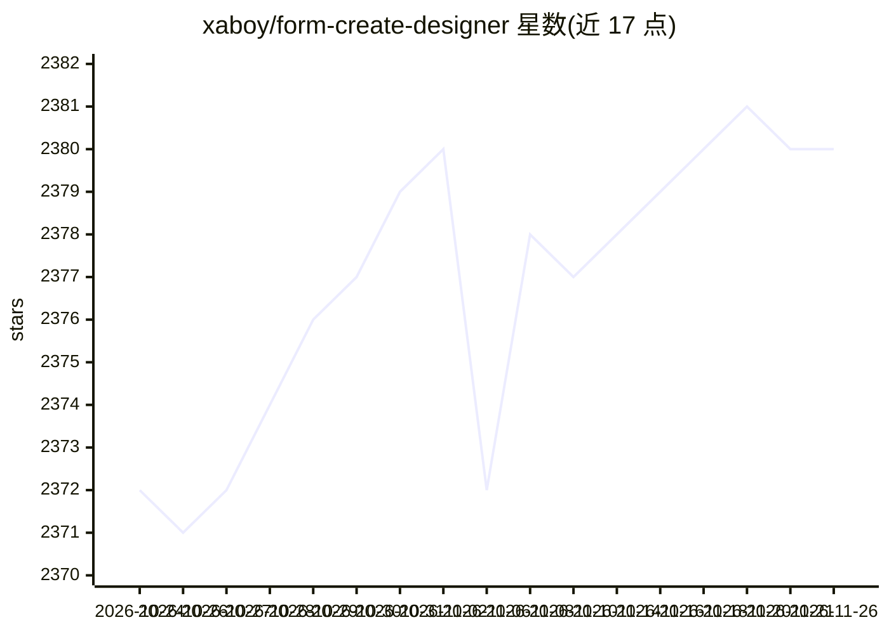

# xaboy/form-create-designer

⭐ 2,380 · Vue · MIT · 推送 2026-11-05 · [GitHub](https://github.com/xaboy/form-create-designer) · [官网](https://view.form-create.com/) · 个人维护 · 中文 README

**Vue 低代码可视化表单设计器，拖拽生成表单并支持 AI 助理**

基于 @form-create 系列与 Element Plus、Ant Design Vue、Vant 实现的表单设计器组件，支持 Vue2/Vue3 与 PC、移动端。核心机制是以 JSON 数据生成表单，内置 40+ 表单与布局组件，提供表单操作 API、验证、子表单、事件与样式配置、多语言等能力。另提供已开源的 AI 表单助理，根据自然语言描述自动生成和修改 FormCreate 表单规则。README 描述其在政务、OA、ERP、电商、流程管理等系统中使用。安装通过 npm 或 CDN 引入。

## 筛选速览

| 维度 | 判定 | 备注 |
|---|---|---|
| AI 角色 | `ai-enhanced` | 去掉 AI 部分产品仍成立 |
| 许可风险 | `permissive` | MIT |
| 部署形态 | `library` | 以包/库形式分发 |
| 模型依赖 | — | README 未给出锁定关系 |
| 硬件要求 | — | 无带数字的原话,不猜 |
| 安装摩擦 | `low` | 无编译、无系统依赖或容器化 |
| 成熟度 | — | 结构信号不足 |

## 能力要点

- 以 JSON 数据生成表单，拖拽式设计器组件
- 内置 40+ 常用表单组件和布局组件
- 提供 Element Plus、Ant Design Vue、Vant 三种 UI 框架版本
- AI 表单助理根据自然语言生成和修改表单规则

## 适用场景

- 在政务或 OA 系统中快速搭建表单页面
- 用自然语言描述让 AI 助理生成表单规则 JSON
- 为移动端应用设计 Vant 风格的表单

## 场景标签

`代码生成` `AI 助手` · 领域:编码与开发

## 证据(README 行号)

> L23: **@form-create/designer** 是基于 @form-create/element-ui 和 **ElementPlus** 实现的AI表单设计器组件。支持Vue2和Vue3
> L31: **AI 表单助理已开源:GitHub | Gitee | AtomGit，用于根据自然语言描述自动生成和修改 FormCreate 表单规则**
> L44: - 支持AI表单助理

## 星数曲线

2026-10-24 2,372 → 2026-11-26 2,380（+8）

---
*卡片 v1 · prompt 1.4 · 生成 2026-11-23 · 置信度 high · 依据 README sha `cfaa5b78d6f4` · [字段定义](../../DATASET.md)*
