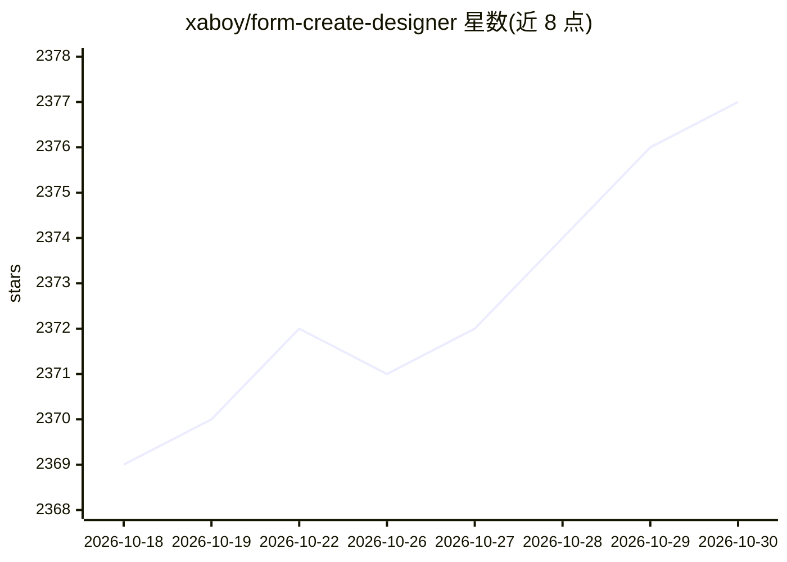

# xaboy/form-create-designer

⭐ 2,377 · Vue · MIT · 推送 2026-09-16 · [GitHub](https://github.com/xaboy/form-create-designer) · [官网](https://view.form-create.com/) · 个人维护 · 中文 README

**Vue 低代码可视化表单设计器组件，含 AI 表单助理**

面向 Vue 开发者的低代码表单设计器组件族：基于 @form-create/element-ui + Element Plus、@form-create/vant + Vant、@form-create/ant-design-vue + Ant Design Vue 分别提供 PC 端与移动端设计器，支持 Vue2/Vue3（视 UI 框架而定）。通过拖拽方式生成 JSON 规则渲染表单，内置 40+ 表单与布局组件，支持自定义组件扩展、事件/样式配置、子表单、验证与多语言。另开源了 AI 表单助理，可根据自然语言描述生成和修改表单规则。以 npm 包或 CDN 引入，MIT 许可。

## 筛选速览

| 维度 | 判定 | 备注 |
|---|---|---|
| AI 角色 | `ai-enhanced` | 去掉 AI 部分产品仍成立 |
| 许可风险 | `permissive` | MIT |
| 部署形态 | `library` | 以包/库形式分发 |
| 模型依赖 | — | README 未给出锁定关系 |
| 硬件要求 | — | 无带数字的原话,不猜 |
| 安装摩擦 | `low` | 无编译、无系统依赖或容器化 |
| 成熟度 | — | 结构信号不足 |

## 能力要点

- 三个 UI 框架版本（Element Plus / Ant Design Vue / Vant 移动端）设计器组件
- JSON 数据生成表单，内置 40+ 组件，支持自定义组件扩展
- AI 表单助理：自然语言生成与修改表单规则（已另行开源）
- 支持子表单/分组、事件与样式配置、表单验证、多语言

## 适用场景

- 在 Vue 项目中嵌入拖拽式表单设计器，让业务人员自行搭建表单
- 政务/OA/ERP 等系统中快速生成与维护复杂表单
- 通过自然语言描述让 AI 助理生成表单规则

## 场景标签

`代码生成` · 领域:编码与开发

## 证据(README 行号)

> L23: **@form-create/designer** 是基于 @form-create/element-ui 和 **ElementPlus** 实现的低代码表单设计器组件。支持Vue2和Vue3
> L31: **AI 表单助理已开源:GitHub | Gitee | AtomGit，用于根据自然语言描述自动生成和修改 FormCreate 表单规则**
> L44: - 支持AI表单助理

## 星数曲线

2026-10-18 2,369 → 2026-10-30 2,377（+8）

---
*卡片 v1 · prompt 1.4 · 生成 2026-10-21 · 置信度 high · 依据 README sha `70d38f04ce19` · [字段定义](../../DATASET.md)*
