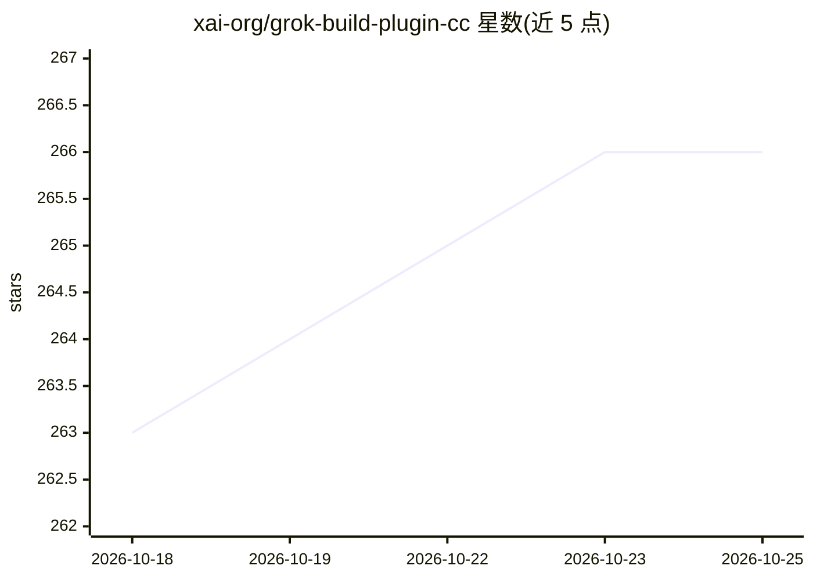

# xai-org/grok-build-plugin-cc

⭐ 266 · JavaScript · Apache-2.0 · 推送 2026-08-04 · [GitHub](https://github.com/xai-org/grok-build-plugin-cc) · 组织维护

**把 Grok CLI 桥接进 Claude Code 的插件：委派审查与导入会话**

Claude Code marketplace 插件，通过 shell 调用真实 `grok` CLI，将 Grok Build 接入 Claude Code。提供斜杠命令：只读 git 状态审查（review）、设计/风险批判（critique）、经子代理委派调查与实现（delegate）、导入 Claude 会话到 Grok（import）、以及 runs/show/stop 运行管理（记录 agentPid 与 bridgePid 并终止进程树）。写权限分层：默认只读（plan 模式 + read-only 沙箱），委派代理按策略加 --write。需 Node>=18.18 与已登录的 grok CLI，无 app-server broker。

## 筛选速览

| 维度 | 判定 | 备注 |
|---|---|---|
| AI 角色 | `ai-ecosystem` | LLM/agent 周边工具 |
| 许可风险 | `permissive` | Apache-2.0 |
| 部署形态 | `None` |  |
| 模型依赖 | locked-api |  |
| 硬件要求 | — | 无带数字的原话,不猜 |
| 安装摩擦 | `low` | 无编译、无系统依赖或容器化 |
| 成熟度 | — | 结构信号不足 |

## 能力要点

- shell 调用真实 grok CLI，运行状态由插件以 PID+日志文件管理
- 写权限分层：桥接默认只读，委派代理按策略可写
- 会话导入（grok import）与 --resume 续接 Grok 会话
- stop 以锁定 CAS 终止 agent 与 bridge 两棵进程树

## 适用场景

- 在 Claude Code 中让 Grok 审查本地 git 改动或做设计批判
- 把调查或修复任务委派给 Grok 子代理执行
- 把当前 Claude 会话导入 Grok 继续处理

## 场景标签

`编码 Agent` · 领域:编码与开发

## 证据(README 行号)

> L3: Bridge Grok Build into Claude Code for review, critique, delegation, and session import.
> L5: This repository is a Claude Code marketplace plugin that shells out to the real `grok` CLI. Run status, results, and

## 星数曲线

2026-10-18 263 → 2026-10-25 266（+3）

---
*卡片 v1 · prompt 1.4 · 生成 2026-10-22 · 置信度 high · 依据 README sha `37495f771b5a` · [字段定义](../../DATASET.md)*
