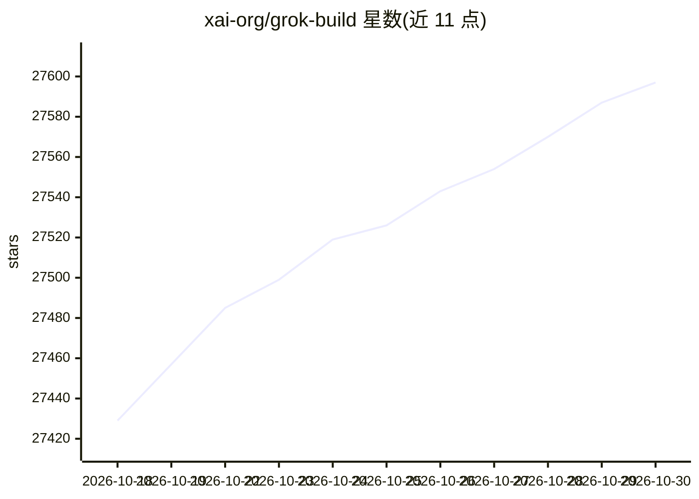

# xai-org/grok-build

⭐ 27,597 · Rust · Apache-2.0 · 推送 2026-09-29 · [GitHub](https://github.com/xai-org/grok-build) · 组织维护

**给开发者的终端 AI 编码 Agent（全屏 TUI）**

SpaceXAI 的终端 AI 编码 Agent，以 Rust 编写、全屏 TUI 形式运行，能理解代码库、编辑文件、执行 shell 命令、搜索网络并管理长时任务；支持交互、无头脚本/CI 模式，以及通过 Agent Client Protocol (ACP) 嵌入编辑器。预编译二进制覆盖 macOS/Linux/Windows，也可从源码构建（Windows 构建为 best-effort）；首次启动需浏览器认证，支持 MCP 服务器、skills、插件、hooks 与沙箱。

## 筛选速览

| 维度 | 判定 | 备注 |
|---|---|---|
| AI 角色 | `ai-native` | 本体是模型或模型工具 |
| 许可风险 | `permissive` | Apache-2.0 |
| 部署形态 | `library` | 以包/库形式分发 |
| 模型依赖 | locked-api |  |
| 硬件要求 | — | 无带数字的原话,不猜 |
| 安装摩擦 | `low` | 无编译、无系统依赖或容器化 |
| 成熟度 | — | 结构信号不足 |

## 动量与使用信号

- 维护:`active` — 距上次 push 18.6 天,年发版 0,1 位贡献者
- 涨星:近 1 天 **+22**(自 20261016 起算)
- 平台:WINDOWS / MACOS / LINUX · 协议:MCP

## 能力要点

- 全屏 TUI，支持鼠标交互
- 交互、无头（脚本/CI）与 ACP 编辑器嵌入三种运行方式
- 支持 MCP 服务器、skills、插件、hooks、沙箱
- 提供 macOS/Linux/Windows 预编译二进制

## 适用场景

- 在终端里让 AI 读写代码库并执行命令
- 在 CI 中以无头模式运行编码任务
- 通过 ACP 将 Agent 集成到编辑器

## 场景标签

`编码 Agent` · 领域:编码与开发

## 证据(README 行号)

> L5: **Grok Build** is SpaceXAI's terminal-based AI coding agent. It runs as a
> L23: This repository contains the Rust source for the `grok` CLI/TUI and its agent
> L31: Prebuilt binaries are published for macOS, Linux, and Windows:

## 星数曲线

2026-10-18 27,429 → 2026-10-30 27,597（+168）

---
*卡片 v1 · prompt 1.4 · 生成 2026-10-18 · 置信度 high · 依据 README sha `f7b222f16da0` · [字段定义](../../DATASET.md)*
