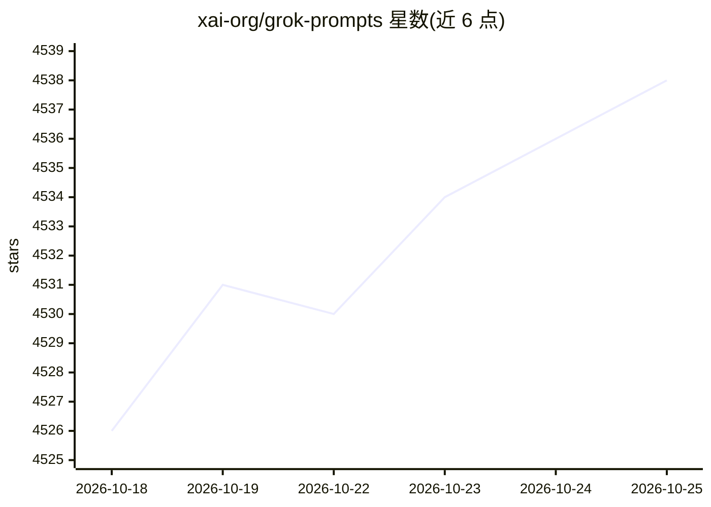

# xai-org/grok-prompts

⭐ 4,545 · Jinja · AGPL-3.0 · 推送 2025-11-17 · [GitHub](https://github.com/xai-org/grok-prompts) · 组织维护

**xAI 公开的 Grok 聊天助手与 X 平台机器人系统提示词集**

由 xAI 维护并持续更新的系统提示词公开仓库：收录 Grok 3 / Grok 4 / Grok 4.1 聊天助手在 grok.com 与 X 上的系统提示词、X 平台 Grok Explain 按钮与 @grok 机器人提示词，以及 grok-code-fast-1、grok-4-fast、grok-4-0709 在 xAI API 上注入的安全提示词前缀。文件为 j2/txt 格式，仅供查阅，仓库不含代码运行流程，以 AGPLv3 许可发布。

## 筛选速览

| 维度 | 判定 | 备注 |
|---|---|---|
| AI 角色 | `ai-knowledge` | 知识聚合/清单类 |
| 许可风险 | `viral` | AGPL-3.0 |
| 部署形态 | `None` |  |
| 模型依赖 | locked-api |  |
| 硬件要求 | — | 无带数字的原话,不猜 |
| 安装摩擦 | `low` | 无编译、无系统依赖或容器化 |
| 成熟度 | — | 结构信号不足 |

## 能力要点

- 覆盖 Grok 3 / 4 / 4.1 各版本系统提示词
- 含 grok.com、X 功能位与 @grok 机器人的产品提示词
- 含 xAI API 模型注入的安全提示词前缀
- 声明随产品迭代定期更新

## 适用场景

- 研究商用聊天助手的系统提示词设计
- 对照不同 Grok 版本提示词的结构变化
- 了解注入式安全提示词前缀的写法

## 场景标签

`提示工程` · 领域:Agent 开发

## 证据(README 行号)

> L3: We are regularly updating this repository with the system prompts that we use for the Grok chat assistant and variou
> L9: * `grok4_system_turn_prompt_v8.j2` - The system prompt for the Grok 4 chat assistant on grok.com and X.

## 星数曲线

2026-10-18 4,526 → 2026-10-25 4,538（+12）

---
*卡片 v1 · prompt 1.4 · 生成 2026-10-21 · 置信度 high · 依据 README sha `2fe983bb5285` · [字段定义](../../DATASET.md)*
