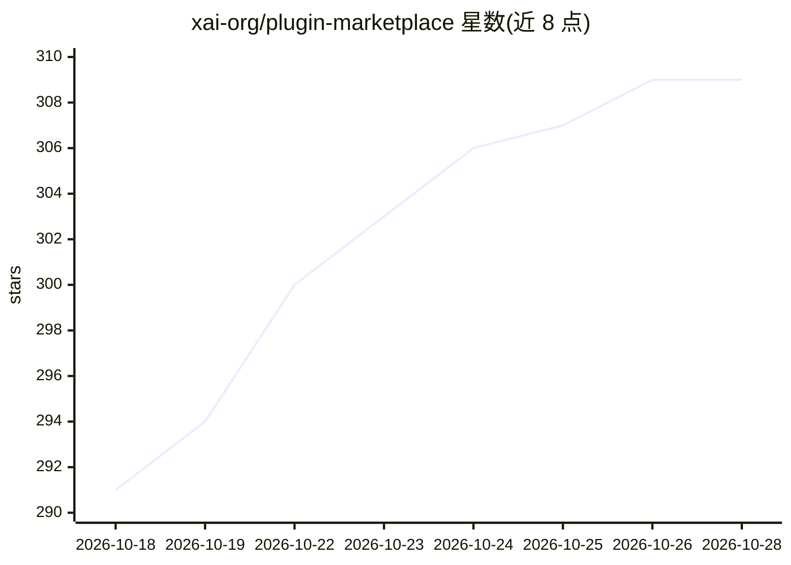

# xai-org/plugin-marketplace

⭐ 309 · Python · 推送 2026-10-27 · [GitHub](https://github.com/xai-org/plugin-marketplace) · 组织维护

**Grok Build 官方插件市场目录：插件索引与分发仓库**

xAI 维护的 Grok Build 插件官方目录仓库：以 .grok-plugin/marketplace.json 为唯一索引，收录第一方插件（plugins/）与第三方插件（external_plugins/），供 Grok Build 浏览、安装与更新。插件可捆绑 SKILL.md 技能、斜杠命令、子代理、生命周期钩子、MCP 与 LSP 服务器配置。远程来源必须钉定 40 位 commit SHA，安装时由 Grok Build 复核；组件索引 plugin-index.json 由脚本生成，CI 校验其未过期。README 附第三方插件免责声明。

## 筛选速览

| 维度 | 判定 | 备注 |
|---|---|---|
| AI 角色 | `ai-knowledge` | 知识聚合/清单类 |
| 许可风险 | `none` | — |
| 部署形态 | `None` |  |
| 模型依赖 | locked-api |  |
| 硬件要求 | — | 无带数字的原话,不猜 |
| 安装摩擦 | `low` | 无编译、无系统依赖或容器化 |
| 成熟度 | — | 结构信号不足 |

## 能力要点

- marketplace.json 单一目录索引，区分第一方/第三方插件来源
- 远程来源强制钉定 40 位 commit SHA 并在克隆后复核
- plugin-index.json 由脚本生成，展示安装前各插件提供的技能/命令/代理/MCP/LSP 组件
- 提供校验脚本与 CI 流程（validator + code-owner 审查）

## 适用场景

- 为 Grok Build 查找并安装官方或第三方插件
- 插件作者向市场提交或更新插件条目
- 了解插件目录格式与 SHA 钉定规范

## 场景标签

`精选清单` · 领域:学习与行业

## 证据(README 行号)

> L3: The official catalog of plugins for Grok Build. This repo is an index that points at plugin sources so Grok Build ca
> L24: A plugin is a directory bundling any combination of:

## 星数曲线

2026-10-18 291 → 2026-10-28 309（+18）

---
*卡片 v1 · prompt 1.4 · 生成 2026-10-21 · 置信度 high · 依据 README sha `8fd103a3090c` · [字段定义](../../DATASET.md)*
