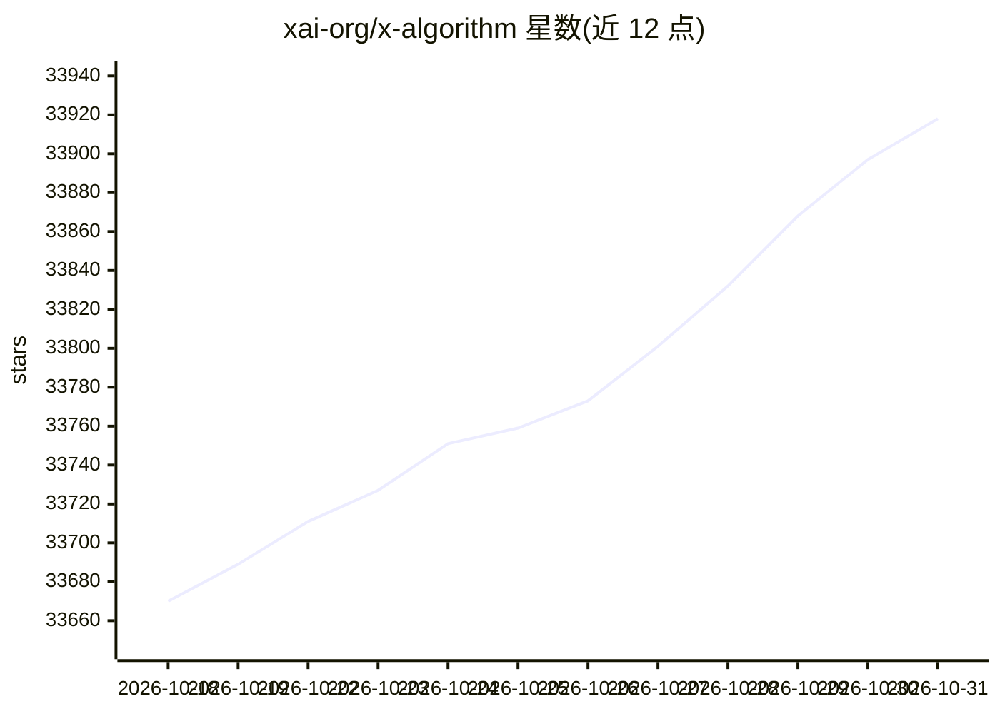

# xai-org/x-algorithm

⭐ 33,918 · Rust · Apache-2.0 · 推送 2026-10-30 · [GitHub](https://github.com/xai-org/x-algorithm) · 组织维护

**X 平台 For You 信息流排序算法的参考实现**

xai-org 开源的 X 平台 For You 信息流核心代码：请求路径上由 Thunder 读取关注账号的在网内容，Phoenix 检索与 SimClusters 提供非关注来源内容，经预过滤、Phoenix 打分（按行为预测概率加权求和）、TopK 选择、可见性过滤后输出时间线；另含标注路径（botmaker 规则、agatha/bdsm 账号评分、媒体模型）驱动 visibility-filtering 的 ALLOW/NOTICE/INTERSTITIAL/DROP 判定。2026 年 8 月版本加入权重配置参数、可见性过滤系统与 Phoenix 训练及合成数据生成代码。README 未给出安装运行步骤。

## 筛选速览

| 维度 | 判定 | 备注 |
|---|---|---|
| AI 角色 | `ai-native` | 本体是模型或模型工具 |
| 许可风险 | `permissive` | Apache-2.0 |
| 部署形态 | `None` |  |
| 模型依赖 | — | README 未给出锁定关系 |
| 硬件要求 | — | 无带数字的原话,不猜 |
| 安装摩擦 | `low` | 无编译、无系统依赖或容器化 |
| 成熟度 | — | 结构信号不足 |

## 动量与使用信号

- 维护:`active` — 距上次 push 1.3 天,年发版 0,2 位贡献者
- 涨星:近 1 天 **+19**(自 20261016 起算)

## 能力要点

- Phoenix 模型按行为预测概率加权合成帖子分数
- visibility-filtering 输出 ALLOW/NOTICE/INTERSTITIAL/DROP 四种可见性判定
- SimClusters 与 popular_posts_source 作为非关注内容候选来源
- Phoenix 训练代码与合成数据生成，可运行概念验证训练

## 适用场景

- 研究 X For You 信息流的检索、打分与过滤机制
- 查看账号或帖子可见性限制背后的规则实现
- 参考工业级信息流系统的架构组织方式

## 场景标签

`推荐系统` · 领域:学习与行业

## 证据(README 行号)

> L3: This repository contains the core code that determines which posts a viewer sees in the **For You** feed on X. It co
> L44: Both are ranked together by the same model. **Phoenix** reads the viewer's recent engagement history and predicts, 
> L30: 1. **Visibility filtering:** `visibility-filtering/` determines whether to show a post, drop it, or show it behind 

## 星数曲线

2026-10-18 33,670 → 2026-10-31 33,918（+248）

---
*卡片 v1 · prompt 1.4 · 生成 2026-10-18 · 置信度 high · 依据 README sha `65954e1862b6` · [字段定义](../../DATASET.md)*
