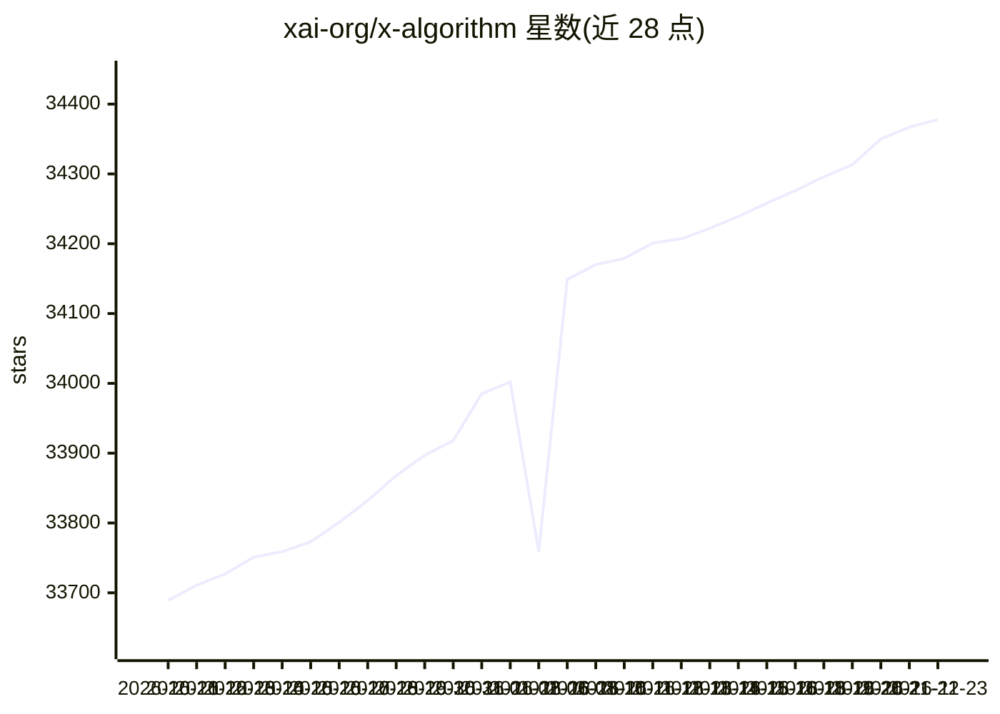

# xai-org/x-algorithm

⭐ 34,378 · Rust · Apache-2.0 · 推送 2026-11-21 · [GitHub](https://github.com/xai-org/x-algorithm) · 组织维护

**X 平台 For You 信息流的推荐排序算法代码**

该仓库包含驱动 X 平台 For You 信息流的核心代码：每条请求从 Thunder（站内关注账号的近期帖子）与 Phoenix 检索、SimClusters、热门帖子列表（站外发现）获取候选，经查询注水、预打分过滤、Phoenix 模型预测用户对各行为（点赞、停留时长等）的概率后加权打分排序，再经可见性过滤与后选过滤产出最终时间线；另含标记路径（内容理解模型、规则引擎、可见性过滤）与合成数据生成代码以运行 Phoenix 的概念验证训练。各阶段可通过 home-mixer 参数开关。

## 筛选速览

| 维度 | 判定 | 备注 |
|---|---|---|
| AI 角色 | `ai-native` | 本体是模型或模型工具 |
| 许可风险 | `permissive` | Apache-2.0 |
| 部署形态 | `None` |  |
| 模型依赖 | — | README 未给出锁定关系 |
| 硬件要求 | — | 无带数字的原话,不猜 |
| 安装摩擦 | `low` | 无编译、无系统依赖或容器化 |
| 成熟度 | — | 结构信号不足 |

## 动量与使用信号

- 维护:`active` — 距上次 push 1.3 天,年发版 0,2 位贡献者
- 涨星:近 1 天 **+19**(自 20261016 起算)

## 能力要点

- Phoenix transformer 模型对每条帖子预测用户行为概率并加权打分
- 可见性过滤输出 ALLOW/NOTICE/INTERSTITIAL/DROP 四种判定
- 标记路径含内容理解模型（grox、clip、media-model-proxy）与规则引擎（botmaker/scarecrow）
- 提供 Phoenix 合成数据生成代码，可运行概念验证训练

## 适用场景

- 研究社交平台信息流的候选检索与排序流程
- 了解帖子可见性过滤与标签系统的实现方式
- 基于合成数据运行 Phoenix 模型的概念验证训练

## 场景标签

`推荐系统` · 领域:学习与行业

## 证据(README 行号)

> L3: This repository contains the core code that determines which posts a viewer sees in the **For You** feed on X. It co
> L56: Both are ranked together by the same model. **Phoenix** reads the viewer's recent engagement history and predicts, 

## 星数曲线

2026-10-21 33,689 → 2026-11-23 34,378（+689）

---
*卡片 v1 · prompt 1.4 · 生成 2026-11-22 · 置信度 high · 依据 README sha `f753e9672c76` · [字段定义](../../DATASET.md)*
