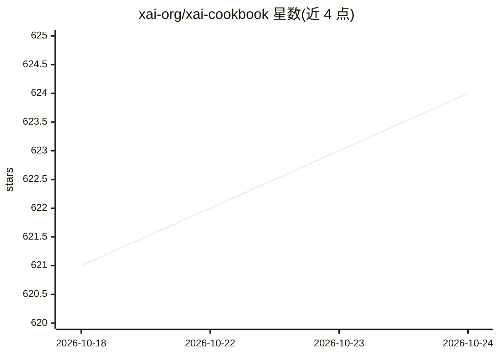

# xai-org/xai-cookbook

⭐ 625 · Python · NOASSERTION · 推送 2026-10-22 · [GitHub](https://github.com/xai-org/xai-cookbook) · 组织维护

**xAI Grok API 的实战示例集：从入门到进阶的 25 个可运行应用**

xAI 官方维护的 cookbook，收录基于 SpaceXSI（xAI）TypeScript SDK 与 Python notebook 的可运行示例：文章转播客、浏览器/电话/iOS/Android 语音 agent、𝕏 实时情感分析、截图转 React 组件、视频配音等，按 Recipes/Guides/Apps 组织并标注难度等级。运行需从 SpaceXSI Console 获取 API key，TypeScript 应用需 Node.js 22.13+，notebook 需 Python 3.12+ 与 uv，调用 API 消耗额度。README 明确声明示例仅供学习、非生产就绪。

## 筛选速览

| 维度 | 判定 | 备注 |
|---|---|---|
| AI 角色 | `ai-knowledge` | 知识聚合/清单类 |
| 许可风险 | `none` | NOASSERTION |
| 部署形态 | `library` | 以包/库形式分发 |
| 模型依赖 | locked-api |  |
| 硬件要求 | — | 无带数字的原话,不猜 |
| 安装摩擦 | `low` | 无编译、无系统依赖或容器化 |
| 成熟度 | — | 结构信号不足 |

## 能力要点

- 25 个基于 xAI SDK 的可运行示例，覆盖语音 agent、图像视频生成、工具调用等 API 能力
- 每个示例为独立文件夹并附 README 说明运行方式与费用
- 涵盖 prompt caching、prompt injection 防御、推理力度评测等进阶主题

## 适用场景

- 学习如何调用 Grok 的语音、图像与工具调用 API
- 以示例代码为起点构建语音 agent 或内容生成应用
- 了解 prompt 注入防御与评测等工程实践

## 场景标签

`教程课程` `语音 Agent` · 领域:对话与助手

## 证据(README 行号)

> L3: Runnable examples for building with Grok: a TypeScript app that turns articles into podcast episodes, complete voice
> L71: Each app in a `typescript/` folder is its own npm project built on the SpaceXSI TypeScript SDK. You'll need Node.js

## 星数曲线

2026-10-18 621 → 2026-10-24 624（+3）

---
*卡片 v1 · prompt 1.4 · 生成 2026-10-21 · 置信度 high · 依据 README sha `4ba5eadec09c` · [字段定义](../../DATASET.md)*
