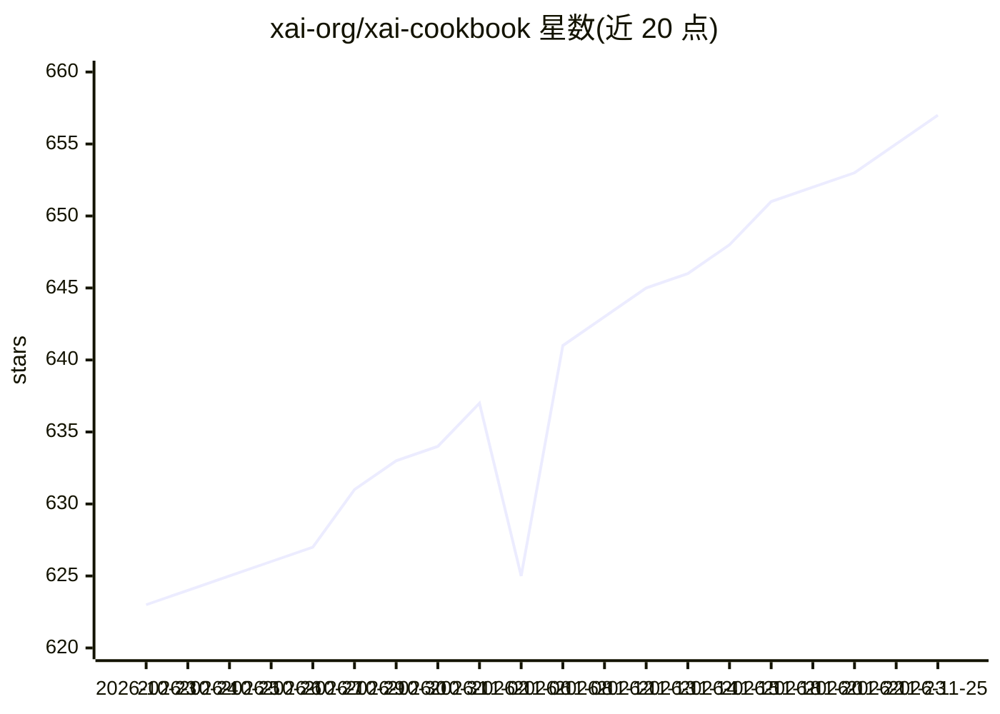

# xai-org/xai-cookbook

⭐ 657 · Python · NOASSERTION · 推送 2026-10-26 · [GitHub](https://github.com/xai-org/xai-cookbook) · 组织维护

**xAI Grok API 官方示例集：25 个可运行应用覆盖语音/视频/Agent**

xAI 官方维护的 Grok API 示例代码库，含 25 个基于 SpaceXSI TypeScript SDK 构建的应用与 Python notebook，按 Recipes/Guides/Apps 三类组织并标注难度。覆盖实时语音（Web/iOS/Android/电话）、图像与视频生成（Grok Imagine）、X 实时数据检索、MCP、批处理、评测等主题。运行需 Node.js 22.13+ 或 Python 3.12+ 与 SpaceXSI Console 的 API key；示例为教学用途，非生产就绪。

## 筛选速览

| 维度 | 判定 | 备注 |
|---|---|---|
| AI 角色 | `ai-knowledge` | 知识聚合/清单类 |
| 许可风险 | `none` | NOASSERTION |
| 部署形态 | `library` | 以包/库形式分发 |
| 模型依赖 | locked-api |  |
| 硬件要求 | — | 无带数字的原话,不猜 |
| 安装摩擦 | `low` | 无编译、无系统依赖或容器化 |
| 成熟度 | — | 结构信号不足 |

## 能力要点

- 25 个可运行示例，按 Recipes/Guides/Apps 分类并标注 Beginner/Intermediate/Advanced 难度
- 覆盖实时语音 API（Web/WebRTC/iOS/Android/Twilio 电话）与 Grok Imagine 视频/图像生成
- 包含 MCP 数据库、提示注入防御、人工审批 Agent、Batch API 等进阶主题
- 预提交钩子自动运行改动的 notebook 并用 Gitleaks 扫描 API key

## 适用场景

- 学习 Grok API 从入门到进阶的各类调用方式
- 复制示例代码搭建语音 Agent、播客生成或实时情绪分析应用
- 参考提示缓存、评测与安全防御等工程实践

## 场景标签

`语音 Agent` `图像生成` `视频生成` `模型评测` · 领域:对话与助手

## 证据(README 行号)

> L3: Runnable examples for building with Grok: a TypeScript app that turns articles into podcast episodes, complete voice
> L19: Every example is a folder under `examples/` with a README that explains what it teaches and how to run it. This lis

## 星数曲线

2026-10-23 623 → 2026-11-25 657（+34）

---
*卡片 v1 · prompt 1.4 · 生成 2026-11-24 · 置信度 high · 依据 README sha `708ea5670b07` · [字段定义](../../DATASET.md)*
