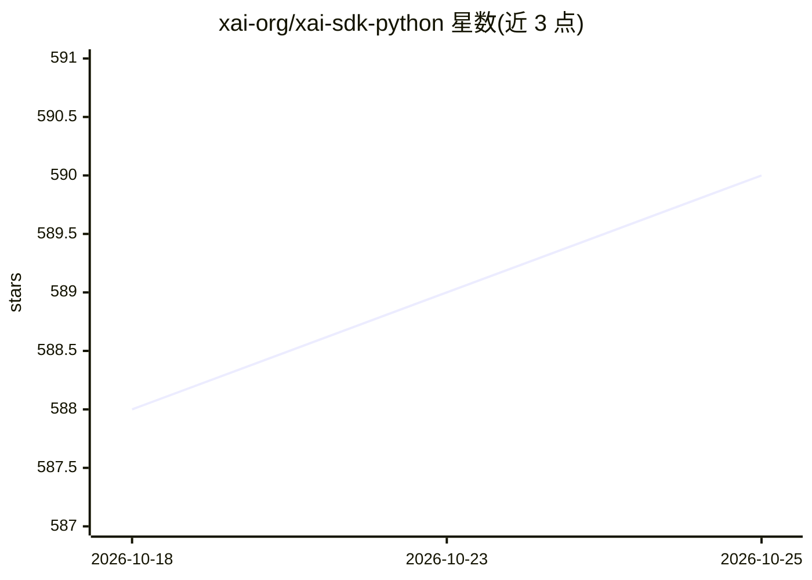

# xai-org/xai-sdk-python

⭐ 590 · Python · Apache-2.0 · 推送 2026-10-23 · [GitHub](https://github.com/xai-org/xai-sdk-python) · 组织维护

**xAI 官方 Python SDK：接入 xAI API 的 gRPC 客户端库**

xAI 官方维护的 gRPC Python 库，供开发者调用 xAI API：同步与异步双客户端，支持多轮对话、流式输出、函数调用、图像理解与生成、grok-imagine-video 视频生成/编辑/扩展、Pydantic 结构化输出、推理模型、延迟轮询采样、分词与模型信息查询。默认从 XAI_API_KEY 环境变量读取认证。可选 OpenTelemetry 遥测导出（控制台或 OTLP 后端）。要求 Python 3.10+，默认超时 27 分钟，UNAVAILABLE 错误自动指数退避重试最多 5 次。

## 筛选速览

| 维度 | 判定 | 备注 |
|---|---|---|
| AI 角色 | `ai-ecosystem` | LLM/agent 周边工具 |
| 许可风险 | `permissive` | Apache-2.0 |
| 部署形态 | `library` | 以包/库形式分发 |
| 模型依赖 | locked-api |  |
| 硬件要求 | — | 无带数字的原话,不猜 |
| 安装摩擦 | `low` | 无编译、无系统依赖或容器化 |
| 成熟度 | — | 结构信号不足 |

## 能力要点

- 同步/异步双客户端，gRPC 通信，默认 27 分钟超时与指数退避重试
- 覆盖对话、流式、函数调用、图像/视频生成与理解、结构化输出
- 服务端 Agent 工具调用：Grok 自主决定搜索网页、𝕏 或执行代码
- 可选 OpenTelemetry 遥测导出，属性遵循 GenAI 语义约定

## 适用场景

- 在 Python 应用中集成 xAI 的对话、图像与视频生成能力
- 构建带函数调用与结构化输出的 Grok 应用
- 通过 OpenTelemetry 追踪与监控 LLM 调用

## 场景标签

`图像生成` `视频生成` · 领域:内容生成

## 证据(README 行号)

> L3:  The official Python SDK for xAI's APIs
> L14: The xAI Python SDK is a gRPC-based Python library for interacting with xAI's APIs. Built for Python 3.10 and above,
> L41: The xAI SDK supports both synchronous (`xai_sdk.Client`) and asynchronous (`xai_sdk.AsyncClient`) clients. For a co

## 星数曲线

2026-10-18 588 → 2026-10-25 590（+2）

---
*卡片 v1 · prompt 1.4 · 生成 2026-10-21 · 置信度 high · 依据 README sha `0c1d487923ae` · [字段定义](../../DATASET.md)*
