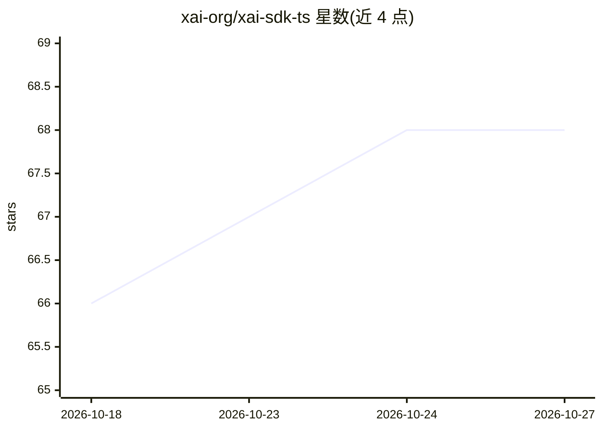

# xai-org/xai-sdk-ts

⭐ 68 · TypeScript · Apache-2.0 · 推送 2026-10-23 · [GitHub](https://github.com/xai-org/xai-sdk-ts) · [官网](https://www.npmjs.com/package/@xai-official/sdk) · 组织维护

**xAI 官方 TypeScript SDK：在 Node.js 中调用 Grok API**

xAI 官方维护的 TypeScript SDK，封装 SpaceXAI REST API，提供类型化的 ESM 客户端，无运行时依赖。功能覆盖流式输出、结构化输出（JSON Schema 与 Zod/Valibot/ArkType/Effect Schema 校验）、函数工具与工具调用循环、shell 工具、图像输入、图像与视频生成、文件上传、批处理、语音合成与转录、多轮对话（toInput/compact）及用量与 HTTP 元数据访问。要求 Node.js 22.13+、ESM 项目与 API key，默认屏蔽浏览器与 Worker 环境以防 key 泄露。项目自声明处于早期实验阶段，接口在 1.0 前可能变更，建议锁定精确版本。

## 筛选速览

| 维度 | 判定 | 备注 |
|---|---|---|
| AI 角色 | `ai-ecosystem` | LLM/agent 周边工具 |
| 许可风险 | `permissive` | Apache-2.0 |
| 部署形态 | `library` | 以包/库形式分发 |
| 模型依赖 | locked-api |  |
| 硬件要求 | — | 无带数字的原话,不猜 |
| 安装摩擦 | `low` | 无编译、无系统依赖或容器化 |
| 成熟度 | `idea` | |

## 能力要点

- 类型化 ESM 客户端，零运行时依赖
- 流式输出与部分 JSON 解析（parsePartialJson）
- 结构化输出支持 Zod/Valibot/ArkType/Effect Schema 校验
- 函数工具、工具调用循环与 shell 工具（支持沙箱执行）

## 适用场景

- 在 Node.js 服务端调用 Grok 模型构建对话或生成功能
- 通过结构化输出获取可校验的 JSON 结果
- 构建可调用自定义函数与 shell 命令的 agent

## 场景标签

 · 领域:LLM 基础设施/开发者工具

## 证据(README 行号)

> L18: Use Grok from TypeScript with a typed, ESM client built on the SpaceXAI REST API. The SDK has no runtime dependenci
> L20: > **Experimental.** This SDK is in early development. It currently covers the Responses API, image and video genera

## 星数曲线

2026-10-18 66 → 2026-10-27 68（+2）

---
*卡片 v1 · prompt 1.4 · 生成 2026-10-24 · 置信度 high · 依据 README sha `339c7659b41d` · [字段定义](../../DATASET.md)*
