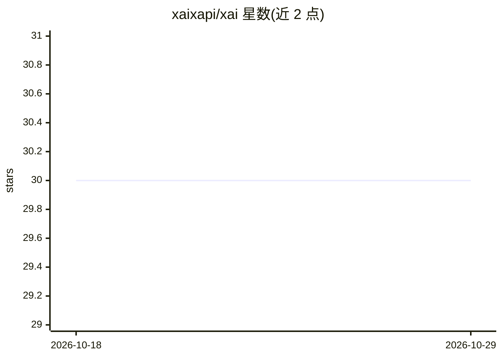

# xaixapi/xai

⭐ 30 · 推送 2026-01-10 · [GitHub](https://github.com/xaixapi/xai) · [官网](https://xairouter.com) · 组织维护 · 中文 README

**AI API 路由与治理平台：统一接入多家大模型供应商**

应用层的 AI API 路由与治理平台，提供统一 API 入口接入多家供应商与本地私有部署的开源模型，含负载均衡、故障切换、密钥轮换、模型映射与多租户子账户体系。产品分三档：云端预充值聚合路由 XAI Router、云端 BYOK 的 XAI Control（零加价、端到端加密密钥存储）、可私有化部署的 XAI Router Private。私有化通过 Docker Compose 与 Nginx 反向代理部署，服务器要求 Linux x86_64、1–2 核、1–2 GB 内存。

## 筛选速览

| 维度 | 判定 | 备注 |
|---|---|---|
| AI 角色 | `ai-ecosystem` | LLM/agent 周边工具 |
| 许可风险 | `none` | — |
| 部署形态 | `self-host` | docker 或自建部署 |
| 模型依赖 | — | README 未给出锁定关系 |
| 硬件要求 | — | 无带数字的原话,不猜 |
| 安装摩擦 | `low` | 无编译、无系统依赖或容器化 |
| 成熟度 | — | 结构信号不足 |

## 能力要点

- 统一路由入口接入多家供应商与模型
- 负载均衡、故障切换、密钥轮换与模型映射
- 多租户子账户、权限控制与用量治理
- 100% BYOK、端到端加密存储与私有化部署选项

## 适用场景

- 通过一个 API 入口统一调用多家大模型
- BYOK 模式下做大规模生产调用与成本管理
- 合规要求下私有化部署 AI API 网关

## 场景标签

`模型网关` · 领域:Agent 开发

## 证据(README 行号)

> L15: XAI 是一个在应用层透明接入的 AI API 路由与治理平台，内置完整的多租户管理体系，支持无缝接入并统一调度全球主流大模型与本地私有部署的开源模型。
> L38: - **API Gateway**：统一路由入口。

## 星数曲线

2026-10-18 30 → 2026-10-29 30（+0）

---
*卡片 v1 · prompt 1.4 · 生成 2026-10-26 · 置信度 high · 依据 README sha `17561ad332d3` · [字段定义](../../DATASET.md)*
