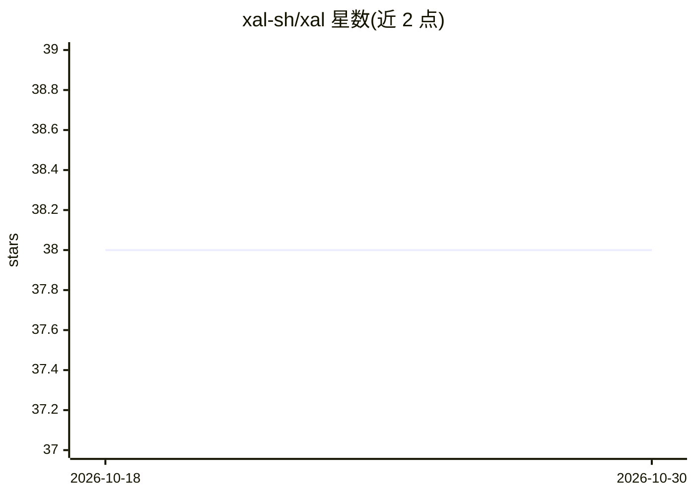

# xal-sh/xal

⭐ 38 · TypeScript · MIT · 推送 2026-10-23 · [GitHub](https://github.com/xal-sh/xal) · [官网](https://xal.sh) · 个人维护

**终端编码代理框架，能力全部插件化的无头 agent 核心**

基于 OpenTUI 的终端编码工具（coding harness），底层为无头 agent 核心，所有能力以插件形式提供。TUI 支持 plan/normal/yolo 三种模式，可通过 config.json 或命令行参数设定；文档覆盖配置、权限、providers、插件、MCP 指南等，并提供公共产品 API 与 OpenAPI 规范用于 CLI 自动化。目前处于 beta 阶段，仅有 beta 发布渠道，稳定版发布前可能出现破坏性变更；安装脚本支持 macOS/Linux/Windows（x64/arm64，glibc 与 musl）。

## 筛选速览

| 维度 | 判定 | 备注 |
|---|---|---|
| AI 角色 | `ai-native` | 本体是模型或模型工具 |
| 许可风险 | `permissive` | MIT |
| 部署形态 | `None` |  |
| 模型依赖 | — | README 未给出锁定关系 |
| 硬件要求 | — | 无带数字的原话,不猜 |
| 安装摩擦 | `low` | 无编译、无系统依赖或容器化 |
| 成熟度 | `idea` | |

## 能力要点

- 无头 agent 核心，所有能力均为插件
- TUI 支持 plan/normal/yolo 三种运行模式
- 安装脚本覆盖 x64/arm64 与 glibc/musl Linux
- 提供公共产品 API、OpenAPI 规范与 MCP 指南

## 适用场景

- 在终端中以 agent 方式进行编码任务
- 通过 plan 模式先审阅计划再执行操作
- 基于插件机制扩展代理能力
- 通过 CLI/API 将编码代理嵌入自动化流程

## 场景标签

`编码 Agent` `Agent 框架` · 领域:Agent 开发

## 证据(README 行号)

> L6: A terminal coding harness with a headless agent core where every capability, is a plugin
> L28: Start the TUI in `plan`, `normal`, or `yolo` mode:

## 星数曲线

2026-10-18 38 → 2026-10-30 38（+0）

---
*卡片 v1 · prompt 1.4 · 生成 2026-10-25 · 置信度 high · 依据 README sha `819f2730cb60` · [字段定义](../../DATASET.md)*
