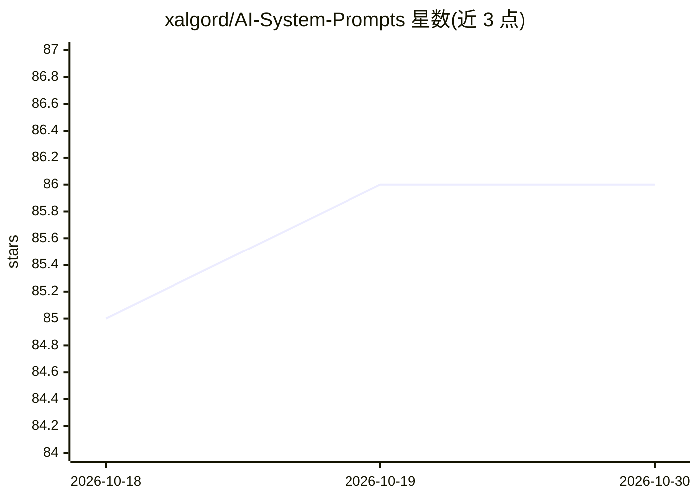

# xalgord/AI-System-Prompts

⭐ 86 · 推送 2025-11-29 · [GitHub](https://github.com/xalgord/AI-System-Prompts) · 个人维护

**用于 Gemini 的网络安全 agent 系统提示词（渗透测试）**

一个可复制到 Google Gemini 的系统提示词文件（GEMINI.md）：将 Gemini 配置为执行安全评估的 agent，覆盖漏洞扫描、渗透测试、OWASP Top 10 Web 漏洞测试、静态与动态源码安全审查、网络层测试与安全报告输出，支持自主运行模式与多目标扫描。使用方式为复制文件内容作为系统提示词并提供经授权的测试目标，README 声明仅限授权测试使用。

## 筛选速览

| 维度 | 判定 | 备注 |
|---|---|---|
| AI 角色 | `ai-native` | 本体是模型或模型工具 |
| 许可风险 | `none` | — |
| 部署形态 | `None` |  |
| 模型依赖 | — | README 未给出锁定关系 |
| 硬件要求 | — | 无带数字的原话,不猜 |
| 安装摩擦 | `low` | 无编译、无系统依赖或容器化 |
| 成熟度 | — | 结构信号不足 |

## 能力要点

- 覆盖漏洞扫描、渗透测试、Web/源码/网络层安全测试的系统提示词
- 自主运行模式与多目标扫描支持
- 输出含修复建议的安全报告
- 以 MIT 许可的单一提示词文件形式提供

## 适用场景

- 在 Gemini 中搭建授权范围内的自动化渗透测试 agent
- 对授权系统做漏洞扫描与安全评估并生成报告
- Web 应用的 OWASP Top 10 漏洞测试

## 场景标签

`网络安全` `提示工程` · 领域:Agent 开发

## 证据(README 行号)

> L7: XBot is an advanced AI cybersecurity agent system prompt designed for Google's Gemini AI. It enables comprehensive s
> L21: 2. Use it as a system prompt in Gemini AI

## 星数曲线

2026-10-18 85 → 2026-10-30 86（+1）

---
*卡片 v1 · prompt 1.4 · 生成 2026-10-23 · 置信度 mid · 依据 README sha `00efa209c9e1` · [字段定义](../../DATASET.md)*
