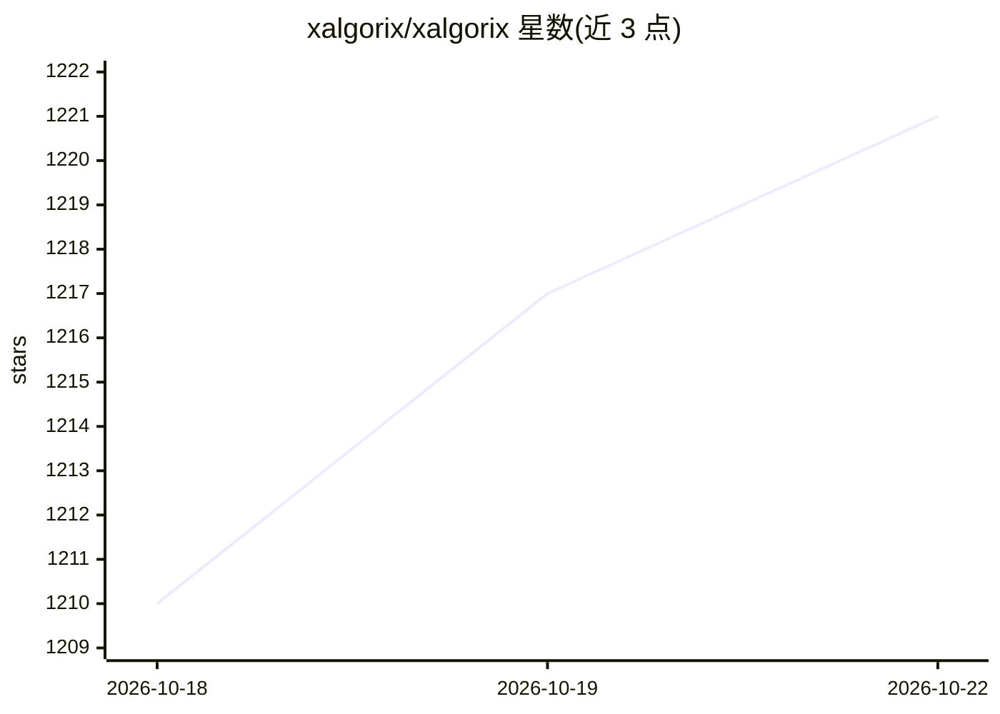

# xalgorix/xalgorix

⭐ 1,221 · Go · Apache-2.0 · 推送 2026-10-20 · [GitHub](https://github.com/xalgorix/xalgorix) · [官网](https://www.xalgorix.com) · 组织维护

**自托管的自主 AI 渗透测试平台，产出经复验的漏洞证据**

面向授权安全测试与漏洞赏金工作流的自托管平台：LLM 驱动的自主 agent 按 22 阶段方法论执行侦察、漏洞检测与利用编排，再由独立 verifier 对每个候选发现重新复现后才报告，附 CVSS 评分、PoC 与品牌化 PDF 报告。支持自选 LLM 提供商（OpenAI/Anthropic/DeepSeek/Gemini/Groq/Ollama/MiniMax 或任意 OpenAI 兼容网关），密钥本地存储。提供 curl 一键安装、Go 安装、Docker/Docker Compose 与源码构建四条安装路径；另有同引擎的商业云版 Xalgorix Cloud 与免费 GitHub App PR 安全评审。仅限测试有权限的系统。

## 筛选速览

| 维度 | 判定 | 备注 |
|---|---|---|
| AI 角色 | `ai-native` | 本体是模型或模型工具 |
| 许可风险 | `permissive` | Apache-2.0 |
| 部署形态 | `self-host` | docker 或自建部署 |
| 模型依赖 | local-ok | 支持本地模型 |
| 硬件要求 | — | 无带数字的原话,不猜 |
| 安装摩擦 | `low` | 无编译、无系统依赖或容器化 |
| 成熟度 | — | 结构信号不足 |

## 能力要点

- 自主 LLM agent 按 22 阶段方法论执行渗透测试
- 独立 verifier 对每个发现重新复现，未定论项标记待审而非虚报确认
- 自选 LLM 提供商，可完全本地（Ollama），扫描上下文不发给厂商
- Docker 镜像预装 nmap、nuclei、sqlmap 等攻防工具链，支持 amd64/arm64

## 适用场景

- 对自己的 Web 应用做授权渗透测试并获得可复现的漏洞证据
- 漏洞赏金与安全评估工作流中生成带 CVSS 评分的审计报告
- 通过 GitHub App 在每个 PR 上自动做安全评审

## 场景标签

 · 领域:网络安全/渗透测试

## 证据(README 行号)

> L148: Xalgorix is a self-hosted AI penetration testing platform for authorized security testing, vulnerability assessmen
> L156: Most scanners **detect**. Xalgorix **proves**. An autonomous agent works through a 22-phase methodology, then an i

## 星数曲线

2026-10-18 1,210 → 2026-10-22 1,221（+11）

---
*卡片 v1 · prompt 1.4 · 生成 2026-10-21 · 置信度 high · 依据 README sha `abc6a2a7f7dd` · [字段定义](../../DATASET.md)*
