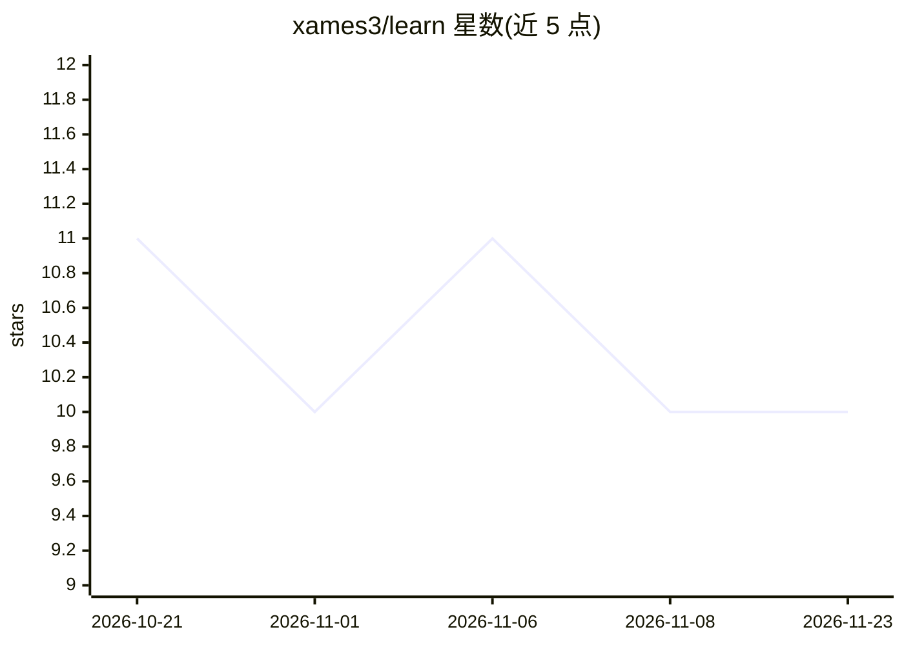

# xames3/learn

⭐ 10 · Python · MIT · 推送 2026-11-13 · [GitHub](https://github.com/xames3/learn) · [官网](http://learn.mes3.dev/) · 个人维护

**AI、研究与数学笔记的在线学习文档站**

以 Sphinx（pydata-sphinx-theme）构建并部署在 learn.mes3.dev 的学习文档项目，内容为 AI、机器学习与数学基础的章节化笔记，含术语解读与数学到神经网络的主线；README 本身仅是目录链接（Preface、Intentions、Demystifying the Buzzwords、Mathematics 等章节），不提供代码安装与运行说明，并集成 giscus 评论。

## 筛选速览

| 维度 | 判定 | 备注 |
|---|---|---|
| AI 角色 | `ai-knowledge` | 知识聚合/清单类 |
| 许可风险 | `permissive` | MIT |
| 部署形态 | `None` |  |
| 模型依赖 | — | README 未给出锁定关系 |
| 硬件要求 | — | 无带数字的原话,不猜 |
| 安装摩擦 | `low` | 无编译、无系统依赖或容器化 |
| 成熟度 | — | 结构信号不足 |

## 能力要点

- 章节化文档：从术语科普到数学与神经网络
- 在线站点 learn.mes3.dev 托管全部内容
- 基于 pydata-sphinx-theme 构建的文档工程
- 集成 giscus 评论（主题标签所示）

## 适用场景

- 按章节学习 AI 与机器学习的基础概念
- 梳理从数学到神经网络的知识脉络
- 查阅 AI 术语（buzzwords）的解释

## 场景标签

`教程课程` · 领域:学习与行业

## 证据(README 行号)

> L3: Learning the Essence of AI, Research and Notations, read more `here <https://learn.mes3.dev/>`_.
> L14: - `Demystifying the Buzzwords <https://learn.mes3.dev/_documentation/chapters/demystifying-buzzwords.html>`_
> L28: - `Mathematics: The Universal Language <https://learn.mes3.dev/_documentation/chapters/mathematics-for-ai.html>`_

## 星数曲线

2026-10-21 11 → 2026-11-23 10（-1）

---
*卡片 v1 · prompt 1.4 · 生成 2026-11-19 · 置信度 high · 依据 README sha `b11bbfb22972` · [字段定义](../../DATASET.md)*
