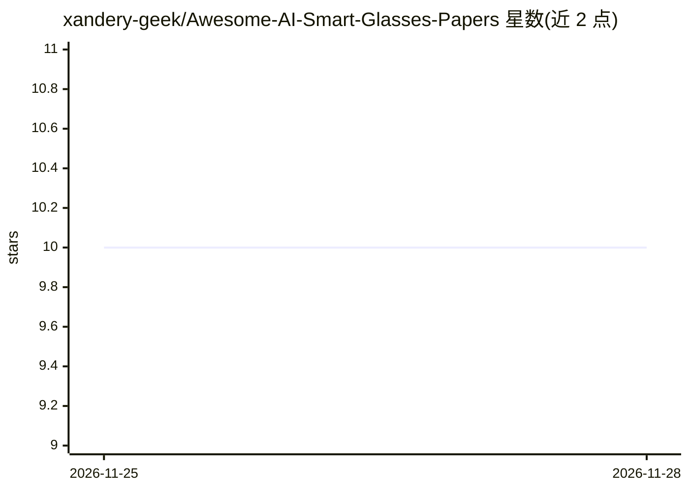

# xandery-geek/Awesome-AI-Smart-Glasses-Papers

⭐ 10 · Apache-2.0 · 推送 2026-09-28 · [GitHub](https://github.com/xandery-geek/Awesome-AI-Smart-Glasses-Papers) · 个人维护

**研究者可用的 AI 智能眼镜论文阅读清单（按综述分类组织）**

配套综述论文《AI Smart Glasses for Wearable Intelligence》的论文集，按四层分类组织：硬件基础、可穿戴智能、交互设计与应用场景，收录智能眼镜与第一视角可穿戴设备相关论文，覆盖感知、情境理解、多模态交互与实际辅助等主题；含代表性智能眼镜产品的参数对比表，许可证为 Apache 2.0，论文预印本可于 arXiv 获取。

## 筛选速览

| 维度 | 判定 | 备注 |
|---|---|---|
| AI 角色 | `ai-knowledge` | 知识聚合/清单类 |
| 许可风险 | `permissive` | Apache-2.0 |
| 部署形态 | `None` |  |
| 模型依赖 | — | README 未给出锁定关系 |
| 硬件要求 | — | 无带数字的原话,不猜 |
| 安装摩擦 | `low` | 无编译、无系统依赖或容器化 |
| 成熟度 | — | 结构信号不足 |

## 能力要点

- 按四层分类（硬件/智能/交互/应用）组织的论文清单
- 含代表性 AI 智能眼镜产品参数对比表（传感器、推理、电池等）
- 配套综述论文预印本发布于 arXiv
- Apache 2.0 许可证

## 适用场景

- 查找智能眼镜第一视角感知相关论文
- 调研可穿戴智能与情境感知研究进展
- 对比主流 AI 智能眼镜产品的硬件参数

## 场景标签

`精选清单` · 领域:学习与行业

## 证据(README 行号)

> L3: A curated reading list for **AI Smart Glasses**, organized according to the taxonomy in our survey paper **AI Smart 
> L25: Following the survey, this list is organized around four connected layers:

## 星数曲线

2026-11-25 10 → 2026-11-28 10（+0）

---
*卡片 v1 · prompt 1.4 · 生成 2026-11-24 · 置信度 high · 依据 README sha `d3f53a395718` · [字段定义](../../DATASET.md)*
