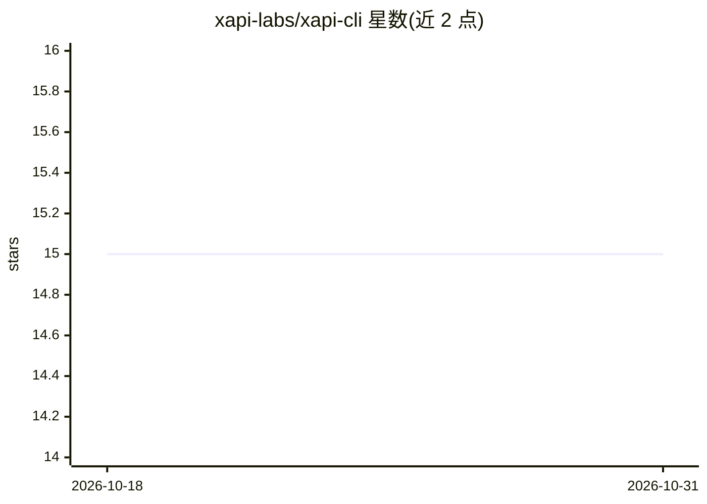

# xapi-labs/xapi-cli

⭐ 15 · TypeScript · MIT · 推送 2026-10-29 · [GitHub](https://github.com/xapi-labs/xapi-cli) · [官网](https://xapi.to) · 组织维护

**面向 AI agent 的 xAPI 命令行客户端：发现并调用第三方 API**

Node.js 18.17+ 上的 CLI，供终端或 AI agent 通过统一接口发现与调用 xAPI 平台上的内置能力与第三方 API（社交、搜索、DNS、加密、BlockPI RPC、Binance Web3、AI 服务等）。提供 skill 安装方式（npx skills add）教 Cursor/Claude Code 等 agent 调用；包含 Action 调用与搜索排序、SSE 流转发、异步任务轮询、provider 命令组（导入/配置/提交/发布自有 API 及计费配置）、sandbox 命令组（按小时计费的云计算机生命周期，默认 $0.20/hour 上限）。写操作不自动重试，凭据字段在输出中脱敏。

## 筛选速览

| 维度 | 判定 | 备注 |
|---|---|---|
| AI 角色 | `ai-ecosystem` | LLM/agent 周边工具 |
| 许可风险 | `permissive` | MIT |
| 部署形态 | `library` | 以包/库形式分发 |
| 模型依赖 | — | README 未给出锁定关系 |
| 硬件要求 | — | 无带数字的原话,不猜 |
| 安装摩擦 | `low` | 无编译、无系统依赖或容器化 |
| 成熟度 | — | 结构信号不足 |

## 能力要点

- 统一 CLI 发现与调用内置能力与第三方 API（--source capability|api 过滤）
- 面向 agent 的 skill 安装（xapi / xapi-provider / xapi-workers 三种）
- provider 命令组完成 API 导入、计费配置、提交审核与发布的完整生命周期
- sandbox 命令组管理按需计费的云计算机实例并执行命令

## 适用场景

- 让 Cursor / Claude Code 等 agent 通过 skill 直接查询价格、调用搜索或链上数据
- API 提供方通过 CLI 注册、配置计费并发布自有服务到 xAPI
- 在临时云沙箱中执行一次性命令并自动清理

## 场景标签

 · 领域:API 基础设施/agent 工具

## 证据(README 行号)

> L3: Agent-friendly command-line interface for xAPI — discover and call capabilities and APIs from your terminal or AI ag
> L24: This installs the bundled `xapi` skill, which teaches the agent
> L25: how to call social, search, domains/DNS, crypto, BlockPI RPC, Binance Web3, and

## 星数曲线

2026-10-18 15 → 2026-10-31 15（+0）

---
*卡片 v1 · prompt 1.4 · 生成 2026-10-30 · 置信度 high · 依据 README sha `b52ef25491e8` · [字段定义](../../DATASET.md)*
