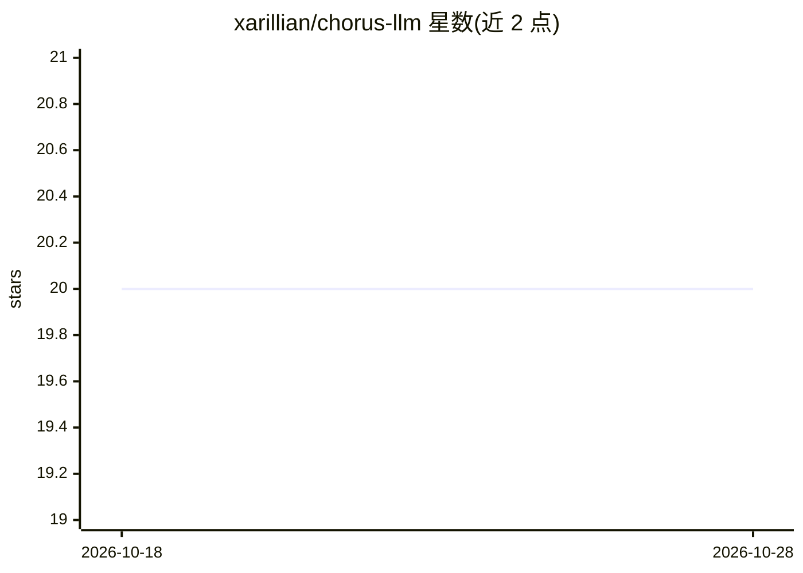

# xarillian/chorus-llm

⭐ 20 · C++ · MIT · 推送 2026-10-23 · [GitHub](https://github.com/xarillian/chorus-llm) · 个人维护

**面向多 agent 应用与游戏的可嵌入本地 LLM 运行时**

基于 llama.cpp 的可嵌入本地推理运行时，C++/C 语言实现，面向原生应用、模拟与游戏（首发支持 Godot 4.4+）。单模型服务多个独立调度的 agent，由 Chorus 自身实现应用级调度器、请求准备、采样、会话生命周期与批处理布局，提供持续批处理、优先级调度、会话独立历史、JSON Schema/GBNF 结构化输出与文本嵌入。以 Vulkan（Linux/Windows）、Metal（Apple Silicon）或 CPU 运行，无需 CUDA、Python 运行时或独立推理服务器。通过 SCons 从源码构建，C ABI 也可进程外托管。

## 筛选速览

| 维度 | 判定 | 备注 |
|---|---|---|
| AI 角色 | `ai-ecosystem` | LLM/agent 周边工具 |
| 许可风险 | `permissive` | MIT |
| 部署形态 | `None` |  |
| 模型依赖 | local-ok | 支持本地模型 |
| 硬件要求 | — | 无带数字的原话,不猜 |
| 安装摩擦 | `high` | 编译与系统依赖俱全 |
| 成熟度 | — | 结构信号不足 |

## 能力要点

- 单模型持续批处理服务多个并发 agent，共享多序列上下文
- JSON Schema/GBNF 结构化输出与逐请求生成参数
- C++ API 与稳定 C ABI，可进程内嵌入或进程外托管
- Godot 4.4+ 引擎集成（typed 资源、signals、Project Settings）

## 适用场景

- 游戏内为多个 NPC/角色并发驱动本地 LLM 对话
- 原生应用中嵌入本地推理，无需独立推理服务
- 需要在应用内做结构化输出与相似度检索嵌入的场景

## 场景标签

`推理引擎` · 领域:训练与推理

## 证据(README 行号)

> L5: **Chorus** is a high-performance embeddable LLM runtime for native applications, simulations, and games.
> L7: Chorus is built for interactive workloads where one model serves many independently scheduled agents. It runs local 
> L9: The current local provider is built on `llama.cpp`, with Vulkan on Linux and Windows and Metal on Apple Silicon. Cho

## 星数曲线

2026-10-18 20 → 2026-10-28 20（+0）

---
*卡片 v1 · prompt 1.4 · 生成 2026-10-28 · 置信度 high · 依据 README sha `8560dc074d1b` · [字段定义](../../DATASET.md)*
