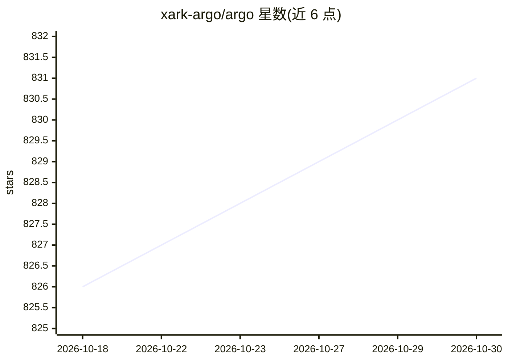

# xark-argo/argo

⭐ 831 · Python · NOASSERTION · 推送 2026-01-06 · [GitHub](https://github.com/xark-argo/argo) · [官网](https://xark-argo.com) · 组织维护 · 中文 README

**本地优先的开源 AI Agent 桌面客户端，支持私有部署与离线 RAG**

跨平台（Windows/macOS/Linux，另有 Web 版）的 AI Agent 客户端：内置 Multi-Agent 任务引擎做意图识别、任务规划、工具调用与自反思，支持 DeepResearch 工作流；通过 Ollama 一键下载运行开源模型（含 HuggingFace GGUF），或接入 OpenAI/Claude/DeepSeek 等 API；提供本地 RAG 知识库（多格式解析、答案溯源、文件夹动态同步）、MCP 工具接入与可视化 Agent Factory。数据全部本地存储，支持离线运行。项目自述仍处早期开发阶段。

## 筛选速览

| 维度 | 判定 | 备注 |
|---|---|---|
| AI 角色 | `ai-native` | 本体是模型或模型工具 |
| 许可风险 | `none` | NOASSERTION |
| 部署形态 | `desktop` | 安装包/桌面程序 |
| 模型依赖 | local-ok | 支持本地模型 |
| 硬件要求 | — | 无带数字的原话,不猜 |
| 安装摩擦 | `low` | 无编译、无系统依赖或容器化 |
| 成熟度 | `idea` | |

## 能力要点

- Multi-Agent 任务引擎：规划-执行-工具调用-自反思闭环
- 一键集成 Ollama 与 HuggingFace GGUF 模型下载，对话中可切换本地/API 模型
- 本地 RAG 知识库：多格式解析、答案溯源、文件夹动态同步
- MCP 协议工具接入（STDIO/SSE）与可视化场景 Agent 定制

## 适用场景

- 在本机离线运行 AI 助手处理复杂任务与研究，数据不出本地
- 把文档、文件夹、网站建成可溯源的本地知识库问答
- 定制法律顾问、行业分析等场景化 Agent 并分享配置

## 场景标签

`AI 助手` `聊天机器人` `多智能体` `文档问答` · 领域:Agent 开发

## 证据(README 行号)

> L20: ARGO is an open-source AI Agent client that makes it easy to **build & use** AI-powered assistants capable of auton
> L26: * 🚀 **Task Execution Engine That Delivers Results** — The Multi-Agent task engine autonomously plans steps, calls t
> L86: - 🤖 **Chat Conversations**:

## 星数曲线

2026-10-18 826 → 2026-10-30 831（+5）

---
*卡片 v1 · prompt 1.4 · 生成 2026-10-21 · 置信度 high · 依据 README sha `351469612fe7` · [字段定义](../../DATASET.md)*
