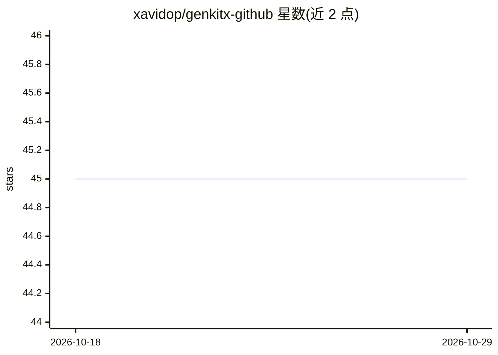

# xavidop/genkitx-github

⭐ 45 · TypeScript · Apache-2.0 · 推送 2026-10-22 · [GitHub](https://github.com/xavidop/genkitx-github) · [官网](https://xavidop.github.io/genkitx-github/) · 个人维护

**Firebase Genkit 的 GitHub Models 社区插件：接入 GitHub Models API**

由 Xavier Portilla Edo 维护的 genkitx-github，是让 Google Firebase Genkit 框架通过官方 API 调用 GitHub Models 的社区插件。支持 GitHub Models 上现有的 Chat/Completion 与 Embeddings 模型，支持图像输入和多模态模型；可通过 customModels 选项注册插件未导出的自定义模型。使用需配置 GITHUB_TOKEN，通过 npm/pnpm 安装；版本需与 Genkit 版本对应（<v0.9.0 用 v1.9.0，>=v0.9.0 用 >=v1.10.0）。已知限制：o1 系列模型仍为 beta 且不支持 system roles 与 tools，Cohere 模型目前仅支持文本输出。

## 筛选速览

| 维度 | 判定 | 备注 |
|---|---|---|
| AI 角色 | `ai-ecosystem` | LLM/agent 周边工具 |
| 许可风险 | `permissive` | Apache-2.0 |
| 部署形态 | `library` | 以包/库形式分发 |
| 模型依赖 | — | README 未给出锁定关系 |
| 硬件要求 | — | 无带数字的原话,不猜 |
| 安装摩擦 | `low` | 无编译、无系统依赖或容器化 |
| 成熟度 | — | 结构信号不足 |

## 能力要点

- 通过 GitHub Models 官方 API 在 Genkit 中调用模型
- 支持 Chat/Completion 与 Embeddings 模型、图像输入与多模态
- customModels 选项可注册插件未导出的自定义模型
- 支持 tool use 与 Genkit flow 内调用

## 适用场景

- 在 Genkit 应用中用 GitHub Token 调用 GPT-4o 等 GitHub Models 模型
- 为 Genkit 工作流添加文本生成、嵌入或工具调用能力
- 接入 GitHub Models 上未内置导出的自定义模型

## 场景标签

`模型网关` · 领域:Agent 开发

## 证据(README 行号)

> L16: **`genkitx-github`** is a community plugin for using GitHub Models APIs with
> L19: This Genkit plugin allows to use GitHub models through their official APIs.
> L98: This plugin supports all currently available **Chat/Completion** and **Embeddings** models from GitHub Models. This

## 星数曲线

2026-10-18 45 → 2026-10-29 45（+0）

---
*卡片 v1 · prompt 1.4 · 生成 2026-10-25 · 置信度 high · 依据 README sha `073df8069262` · [字段定义](../../DATASET.md)*
