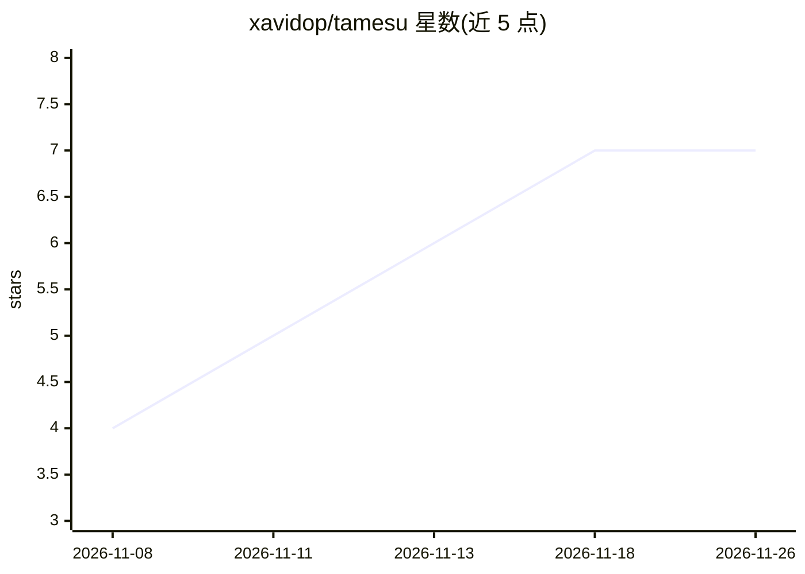

# xavidop/tamesu

⭐ 7 · Go · MIT · 推送 2026-11-23 · [GitHub](https://github.com/xavidop/tamesu) · [官网](https://xavidop.github.io/tamesu/) · 个人维护

**AI Agent 与 Web 应用的 YAML 化测试 CLI：CI 中模拟用户验证**

Go 编写的开源 agentic 测试框架与 CLI：用 YAML 定义 persona、scenario、target 与 assertions，模拟用户与 agent 对话或驱动 web/桌面应用，用确定性检查加结构化 LLM judge 评分。覆盖 12 类测试目标（browser/rest/grpc/livekit/sip/twilio/realtime/pipecat/voice/model/mcp/a2a），支持从真实对话导入测试、从 PRD 生成测试、映射 OWASP LLM Top 10 的红队 playbook。面向在 CI 中回归测试 agent 的开发者，提供 macOS/Windows/Linux 安装包、Docker 镜像与 go install。

## 筛选速览

| 维度 | 判定 | 备注 |
|---|---|---|
| AI 角色 | `ai-ecosystem` | LLM/agent 周边工具 |
| 许可风险 | `permissive` | MIT |
| 部署形态 | `library` | 以包/库形式分发 |
| 模型依赖 | — | README 未给出锁定关系 |
| 硬件要求 | — | 无带数字的原话,不猜 |
| 安装摩擦 | `low` | 无编译、无系统依赖或容器化 |
| 成熟度 | — | 结构信号不足 |

## 能力要点

- 12 类测试目标共享同一 YAML schema、断言、指标与报告
- 结构化 LLM judge：版本化提示、可重放判定、judge 校准命令
- tamesu import 重放真实对话，tamesu generate 从 PRD 起草测试
- 音频测试测量首响时间、打断停止时间等传输层指标

## 适用场景

- 在 CI 里对语音/聊天 agent 做回归测试
- 用红队 playbook 检测 prompt 注入与数据泄露
- 从录制的真实对话生成测试用例
- 浏览器与桌面应用的 agentic 端到端测试

## 场景标签

`模型评测` `浏览器自动化` · 领域:效率与自动化

## 证据(README 行号)

> L7: *An open-source agentic testing framework and CLI in Go: describe a test in YAML, a simulated
> L20: `tamesu` (試す, Japanese for *to try, to test*) turns those checks into a suite you run in CI.
> L119: with the agent skill, or give it the tools: `tamesu mcp` is an MCP server with

## 星数曲线

2026-11-08 4 → 2026-11-26 7（+3）

---
*卡片 v1 · prompt 1.4 · 生成 2026-11-20 · 置信度 mid · 依据 README sha `20045ac2cf0d` · [字段定义](../../DATASET.md)*
