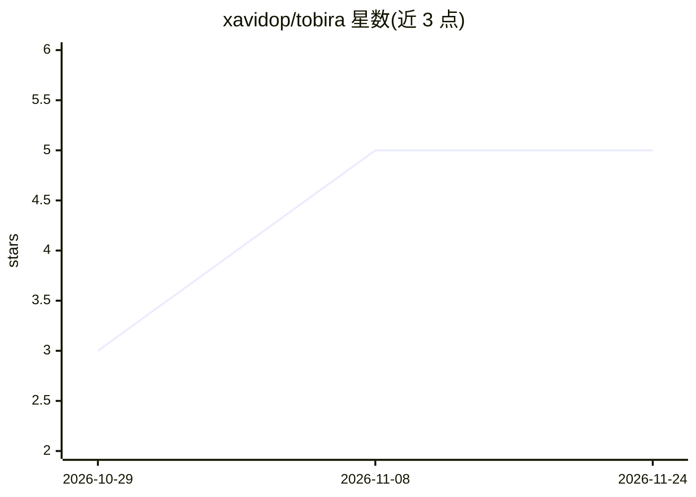

# xavidop/tobira

⭐ 5 · Go · MIT · 推送 2026-11-19 · [GitHub](https://github.com/xavidop/tobira) · [官网](https://xavidop.github.io/tobira/) · 个人维护

**一个终端客户端统一浏览/查询/解释多种数据库，内置只读防护**

单二进制的 CLI 与终端 UI，通过 32 个内置驱动加 DuckDB 插件连接 SQL、文档、键值、宽列、图、时序、搜索与向量数据库，提供连接侧栏、数据网格、查询编辑器、跨源联邦查询、行内编辑与实时变更流。每个驱动前置只读防护，写操作被拒绝并返回退出码。查询可输出 table/JSON/NDJSON/CSV 并返回明确退出码以用于脚本与 CI。AI 部分为可选功能：`tobira ask` 自然语言生成查询，`tobira mcp` 将所选连接暴露给 MCP 客户端。支持 Homebrew/Scoop/Linux 包/二进制/源码安装。

## 筛选速览

| 维度 | 判定 | 备注 |
|---|---|---|
| AI 角色 | `ai-enhanced` | 去掉 AI 部分产品仍成立 |
| 许可风险 | `permissive` | MIT |
| 部署形态 | `library` | 以包/库形式分发 |
| 模型依赖 | local-ok | 支持本地模型 |
| 硬件要求 | — | 无带数字的原话,不猜 |
| 安装摩擦 | `low` | 无编译、无系统依赖或容器化 |
| 成熟度 | — | 结构信号不足 |

## 能力要点

- 32 个内置驱动加 DuckDB 插件，覆盖 SQL/文档/键值/图/时序/向量等多类数据库
- 只读防护内置于每个驱动，防止只读连接产生写入
- 跨源联邦查询：多连接各自执行原生查询后在本地 SQLite join
- `tobira ask` 自然语言查询与 `tobira mcp` MCP 服务器（可选 AI 功能）

## 适用场景

- 在终端里用同一套按键和命令浏览/查询多种数据库
- 以只读方式安全浏览生产库
- 跨多个数据源做联邦 join 查询
- 把数据库连接通过 MCP 暴露给编码 agent

## 场景标签

`数据分析` · 领域:效率与自动化

## 证据(README 行号)

> L7: *One CLI and terminal UI to browse, query and explain SQL, document, key-value, time-series and
> L25: With tobira you browse, query and edit all of them from one terminal app, with the same keys and
> L29: **AI ready.** Ask questions in plain language with `tobira ask` or the AI panel, using Gemini,

## 星数曲线

2026-10-29 3 → 2026-11-24 5（+2）

---
*卡片 v1 · prompt 1.4 · 生成 2026-11-21 · 置信度 mid · 依据 README sha `b55a9c462552` · [字段定义](../../DATASET.md)*
