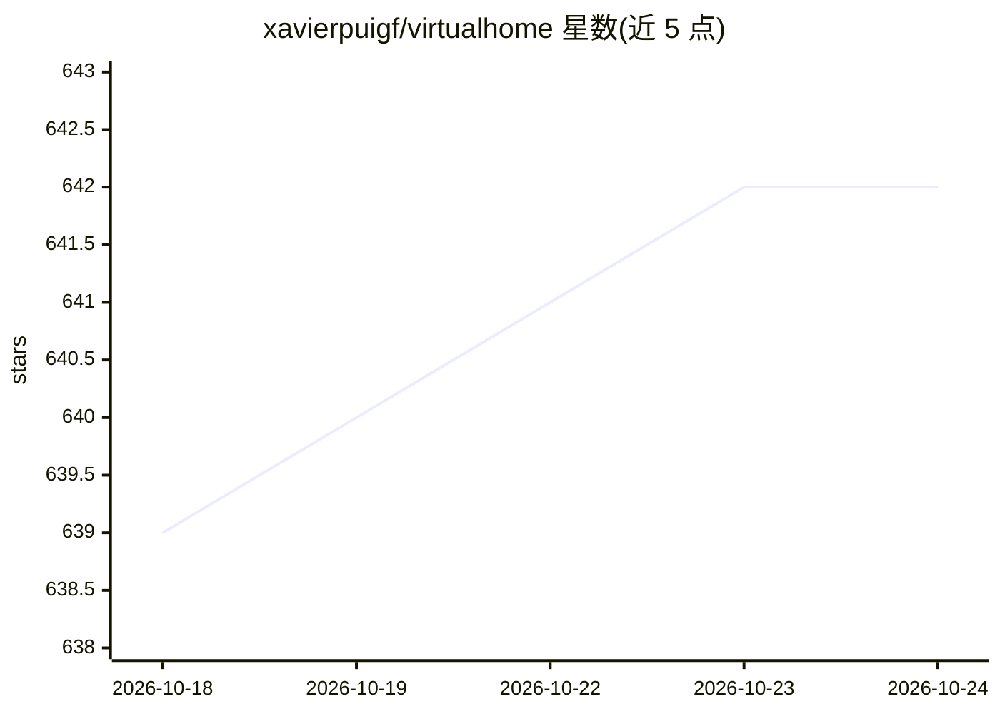

# xavierpuigf/virtualhome

⭐ 642 · Python · MIT · 推送 2026-05-20 · [GitHub](https://github.com/xavierpuigf/virtualhome) · [官网](http://virtual-home.org) · 组织维护

**多智能体家庭活动模拟器：供具身 AI 研究训练与评测**

基于 Unity 与 Python API 的家庭活动仿真平台：活动以程序（动作序列）与环境图两种组件表示，模拟器执行程序后生成活动视频或环境演化图序列。包含 Unity Simulator（渲染视频，需下载可执行文件）与 Evolving Graph（纯 Python 图演化）两个模拟器，支持程序化生成环境、多智能体活动、流式输出分割图/光流/深度等真值，并提供 OpenAI Gym 风格 RL 环境类、配套活动程序数据集与 Ray 并行示例。面向具身 AI 与强化学习研究者。

## 筛选速览

| 维度 | 判定 | 备注 |
|---|---|---|
| AI 角色 | `ai-ecosystem` | LLM/agent 周边工具 |
| 许可风险 | `permissive` | MIT |
| 部署形态 | `library` | 以包/库形式分发 |
| 模型依赖 | — | README 未给出锁定关系 |
| 硬件要求 | — | 无带数字的原话,不猜 |
| 安装摩擦 | `low` | 无编译、无系统依赖或容器化 |
| 成熟度 | — | 结构信号不足 |

## 能力要点

- 程序+图双组件表示，Unity Simulator 渲染视频、Evolving Graph 生成图序列
- 流式输出时间戳动作、实例/语义分割、光流与深度等真值
- 提供 Gym 风格 RL 环境类，可结合 Ray 并行运行多个环境
- 配套活动程序数据集及 KB-RealEnv / KB-ExceptionHandler 脚本增强工具

## 适用场景

- 在仿真家庭环境中训练和评测具身 AI / RL 智能体
- 生成带分割、深度、光流真值的活动视频用于感知研究
- 研究多智能体协作的家庭活动场景

## 场景标签

`模型评测` `强化学习` · 领域:评测与运维

## 证据(README 行号)

> L8: **VirtualHome** is an interactive platform to simulate complex household activities via programs. Key aspect of Virt
> L30: * We include OpenAI Gym like environments to train RL agents with VirtualHome. Check out the unity_environment.py c
> L131: VirtualHome can be used as an environment for Reinforcement Learning. We provide a base class `UnityEnvironment` i

## 星数曲线

2026-10-18 639 → 2026-10-24 642（+3）

---
*卡片 v1 · prompt 1.4 · 生成 2026-10-21 · 置信度 high · 依据 README sha `e43c328e35e0` · [字段定义](../../DATASET.md)*
