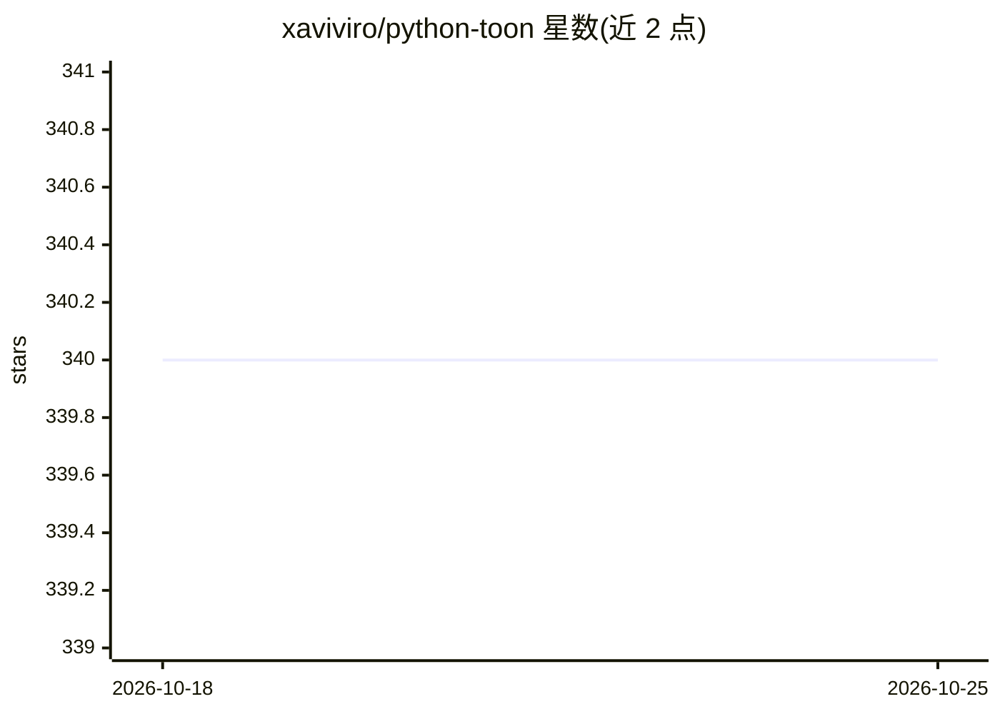

# xaviviro/python-toon

⭐ 340 · Python · MIT · 推送 2026-09-29 · [GitHub](https://github.com/xaviviro/python-toon) · 个人维护

**TOON 格式的 Python 编解码库，降低 LLM 传输 token 量**

TOON（Token-Oriented Object Notation）的非官方 Python 实现，提供 encode/decode API 与命令行工具，在 JSON 与 TOON 间转换。格式用缩进表示嵌套、CSV 式表格表示同构数据行，在均匀数据上比 JSON 减少 30-60% token。解码默认严格校验（计数、语法、缩进、结构），纯 Python 无依赖，支持 3.8+，通过官方规范 4.1 的语言无关测试套件。README 提示 token 节省随分词器与数据形态波动，深层嵌套非均匀数据可能不省甚至更费。

## 筛选速览

| 维度 | 判定 | 备注 |
|---|---|---|
| AI 角色 | `ai-enhanced` | 去掉 AI 部分产品仍成立 |
| 许可风险 | `permissive` | MIT |
| 部署形态 | `library` | 以包/库形式分发 |
| 模型依赖 | — | README 未给出锁定关系 |
| 硬件要求 | — | 无带数字的原话,不猜 |
| 安装摩擦 | `low` | 无编译、无系统依赖或容器化 |
| 成熟度 | — | 结构信号不足 |

## 能力要点

- encode/decode 双向转换，解码默认严格校验
- 官方规范 toon-spec 4.1 全量 fixture 测试通过
- 纯 Python、零依赖、支持 Python 3.8+
- 提供 JSON↔TOON 命令行转换工具

## 适用场景

- 把结构化数据编码成 TOON 喂给 LLM 以降低 token 成本
- 要求模型以 TOON 格式输出并用严格模式解码校验
- 在 JSON 管道中引入更紧凑的中间表示

## 场景标签

 · 领域:数据格式/LLM 工具链

## 证据(README 行号)

> L7: A compact data format optimized for transmitting structured information to Large Language Models (LLMs) with 30-60% 
> L266: ## LLM Integration Best Practices

## 星数曲线

2026-10-18 340 → 2026-10-25 340（+0）

---
*卡片 v1 · prompt 1.4 · 生成 2026-10-23 · 置信度 high · 依据 README sha `505dbff88f04` · [字段定义](../../DATASET.md)*
