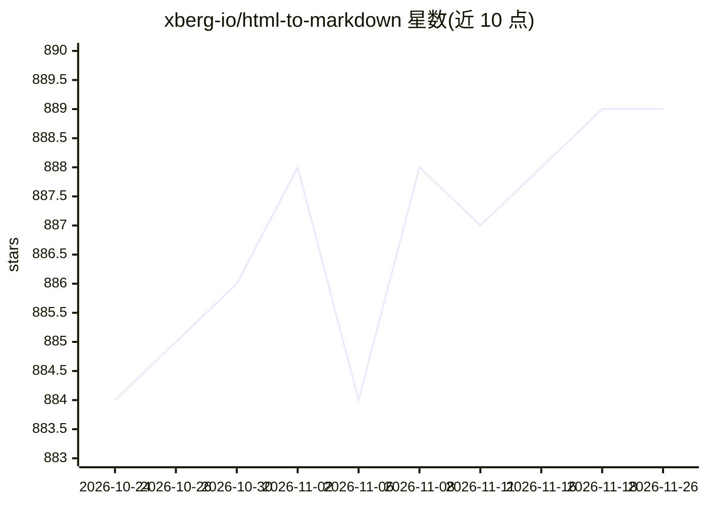

# xberg-io/html-to-markdown

⭐ 889 · HTML · MIT · 推送 2026-11-25 · [GitHub](https://github.com/xberg-io/html-to-markdown) · [官网](https://docs.html-to-markdown.xberg.io) · 组织维护

**面向开发者的多语言 HTML 转 Markdown 转换库**

以 Rust 为核心的 HTML→Markdown 转换引擎，提供 16 种语言的绑定（Python、Node.js、Go、Java、Ruby 等）以及 CLI。输入为真实世界中不规范的 HTML（未闭合标签、CDATA、嵌套表格、混合编码），输出 CommonMark 或 Djot，单次 convert() 调用同时可提取 Open Graph、Twitter、JSON-LD 等页面元数据。分层派发机制（字节扫描→DOM 遍历→html5ever 修复）保证各语言输出一致；附带 Visitor API 用于转换后处理。Rust crate 要求 Rust 1.99+。

## 筛选速览

| 维度 | 判定 | 备注 |
|---|---|---|
| AI 角色 | `ai-enhanced` | 去掉 AI 部分产品仍成立 |
| 许可风险 | `permissive` | MIT |
| 部署形态 | `library` | 以包/库形式分发 |
| 模型依赖 | — | README 未给出锁定关系 |
| 硬件要求 | — | 无带数字的原话,不猜 |
| 安装摩擦 | `medium` | 含编译或系统依赖之一 |
| 成熟度 | — | 结构信号不足 |

## 能力要点

- 16 种语言绑定共享同一 Rust 核心，跨语言输出字节一致
- 支持 GFM 表格、Djot 输出与结构化元数据提取（Open Graph/Twitter/JSON-LD/microdata/RDFa）
- Visitor API 可对转换后的 Markdown AST 做遍历变换
- 提供 CLI（html-to-markdown / h2m）及 AI 编码助手的 agent skills 插件

## 适用场景

- 为 RAG 流水线做 HTML 正文与表格的文本抽取
- 批量爬取页面后统一转为 Markdown 存档
- 在多种语言项目中保持同一转换结果

## 场景标签

`文档解析` · 领域:知识与检索

## 证据(README 行号)

> L76: Feed html-to-markdown the HTML you actually have — unclosed tags, CDATA, custom elements, broken entities, nested t
> L84: |**16 languages, one Rust core**|Rust, Python, Node.js, WASM, Java, Go, C#, PHP, Ruby, Elixir, R, Dart, Kotlin (And
> L241: ### AI Coding Assistants

## 星数曲线

2026-10-24 884 → 2026-11-26 889（+5）

---
*卡片 v1 · prompt 1.4 · 生成 2026-11-24 · 置信度 high · 依据 README sha `21b785343a89` · [字段定义](../../DATASET.md)*
