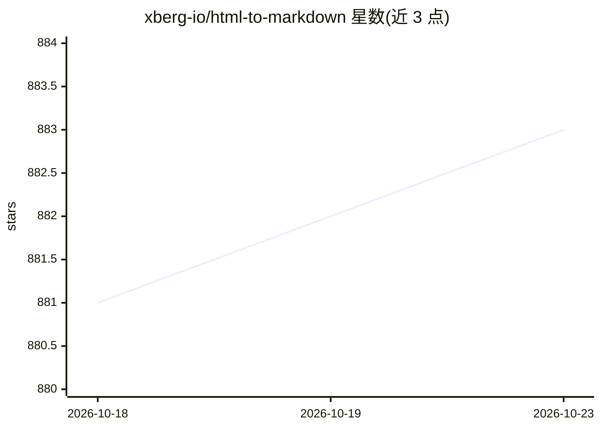

# xberg-io/html-to-markdown

⭐ 883 · HTML · MIT · 推送 2026-10-22 · [GitHub](https://github.com/xberg-io/html-to-markdown) · [官网](https://docs.html-to-markdown.xberg.io) · 组织维护

**多语言绑定的 HTML 转 Markdown 转换库，单一 Rust 内核**

以 Rust 为单一内核、通过绑定覆盖 16 种语言（Python/Node.js/Go/Java/C#/PHP/Ruby/Elixir/R/Dart/Kotlin/Swift/Zig/WASM/C ABI 等）的 HTML 到 Markdown 转换库，单入口 convert() 返回结构化结果。采用三级分派（字节扫描→DOM 遍历→html5ever 修复）处理未闭合标签、CDATA、嵌套表格等不规则输入，支持 GFM 表格、Djot 输出、Open Graph/Twitter/JSON-LD 元数据提取与 Visitor API。另提供 CLI 与面向 Claude Code、Cursor 等 AI 编码助手的插件/Agent Skills。MIT 许可。

## 筛选速览

| 维度 | 判定 | 备注 |
|---|---|---|
| AI 角色 | `ai-enhanced` | 去掉 AI 部分产品仍成立 |
| 许可风险 | `permissive` | MIT |
| 部署形态 | `library` | 以包/库形式分发 |
| 模型依赖 | — | README 未给出锁定关系 |
| 硬件要求 | — | 无带数字的原话,不猜 |
| 安装摩擦 | `medium` | 含编译或系统依赖之一 |
| 成熟度 | — | 结构信号不足 |

## 能力要点

- 16 种语言绑定共用一个 Rust 内核，各绑定输出一致
- 三级分派处理不规则 HTML（未闭合标签/CDATA/混合编码等）
- 元数据提取（Open Graph/Twitter/JSON-LD/microdata/RDFa）
- 提供 CLI 与面向多种 AI 编码助手的插件/Agent Skills

## 适用场景

- 为 RAG 或语料处理管道把网页 HTML 清洗为 Markdown
- 在全语料规模下批量转换并提取页面元数据
- 在 Claude Code/Cursor 等 AI 编码助手中直接调用转换能力

## 场景标签

 · 领域:文本处理/文档转换

## 证据(README 行号)

> L76: Feed html-to-markdown the HTML you actually have — unclosed tags, CDATA, custom elements, broken entities, nested t
> L84: |**16 languages, one Rust core**|Rust, Python, Node.js, WASM, Java, Go, C#, PHP, Ruby, Elixir, R, Dart, Kotlin (And
> L239: Install the html-to-markdown plugin from `xberg-io/html-to-markdown`. It ships the html-to-markdown agent skills —

## 星数曲线

2026-10-18 881 → 2026-10-23 883（+2）

---
*卡片 v1 · prompt 1.4 · 生成 2026-10-21 · 置信度 high · 依据 README sha `5100afd68c04` · [字段定义](../../DATASET.md)*
