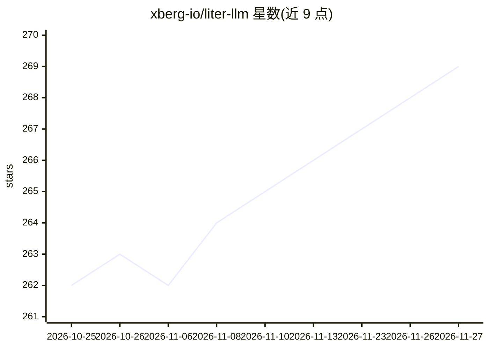

# xberg-io/liter-llm

⭐ 269 · Rust · MIT · 推送 2026-11-26 · [GitHub](https://github.com/xberg-io/liter-llm) · [官网](https://docs.liter-llm.xberg.io) · 组织维护

**多语言 LLM 统一 API 客户端：一个客户端接入 174 家供应商**

基于 Rust 核心的统一 LLM API 客户端，将 174 个供应商（OpenAI、Anthropic、Google、AWS Bedrock 等）封装在同一接口后，切换模型只需改模型名。同一核心发布到 14 种语言的原生绑定，并附带 OpenAI 兼容的 drop-in 代理（22 端点）与 MCP 工具服务器，三者打包进单个 35 MB 二进制。内置按成本/延迟/权重的路由与自动回退、限流、缓存、成本追踪，API key 默认脱敏处理，通过 TOML 文件配置。

## 筛选速览

| 维度 | 判定 | 备注 |
|---|---|---|
| AI 角色 | `ai-ecosystem` | LLM/agent 周边工具 |
| 许可风险 | `permissive` | MIT |
| 部署形态 | `desktop` | 安装包/桌面程序 |
| 模型依赖 | local-ok | 支持本地模型 |
| 硬件要求 | — | 无带数字的原话,不猜 |
| 安装摩擦 | `low` | 无编译、无系统依赖或容器化 |
| 成熟度 | — | 结构信号不足 |

## 能力要点

- 174 个供应商经一个统一 chat API 调用，改模型名即切换
- 14 种语言原生绑定（Rust/Python/Go/Java/C#/Ruby 等）共享同一 Rust 核心
- 单个 35 MB 二进制包含客户端、OpenAI 兼容代理与 MCP 工具服务器
- 面向 Claude Code、Cursor、Codex 等 AI 编码助手的插件与 Agent Skills 分发

## 适用场景

- 在多语言项目中用同一套代码调用不同 LLM 供应商
- 为现有 OpenAI SDK 接入网关代理，不改代码切换模型
- 为 AI 编码助手提供跨 174 家供应商的 chat/工具/embeddings 技能

## 场景标签

`模型网关` · 领域:Agent 开发

## 证据(README 行号)

> L71: liter-llm gives you a single, consistent way to call any large language model. Reach 174 providers — OpenAI, Anthro
> L76: - **One small binary** — the client, a drop-in OpenAI-compatible proxy, and an MCP server for AI agents ship in a s
> L96: |**Local LLM support**|Ollama through its native API; LM Studio, vLLM, llama.cpp, LocalAI, and llamafile through Op

## 星数曲线

2026-10-25 262 → 2026-11-27 269（+7）

---
*卡片 v1 · prompt 1.4 · 生成 2026-11-25 · 置信度 high · 依据 README sha `0f4f39c4c93f` · [字段定义](../../DATASET.md)*
