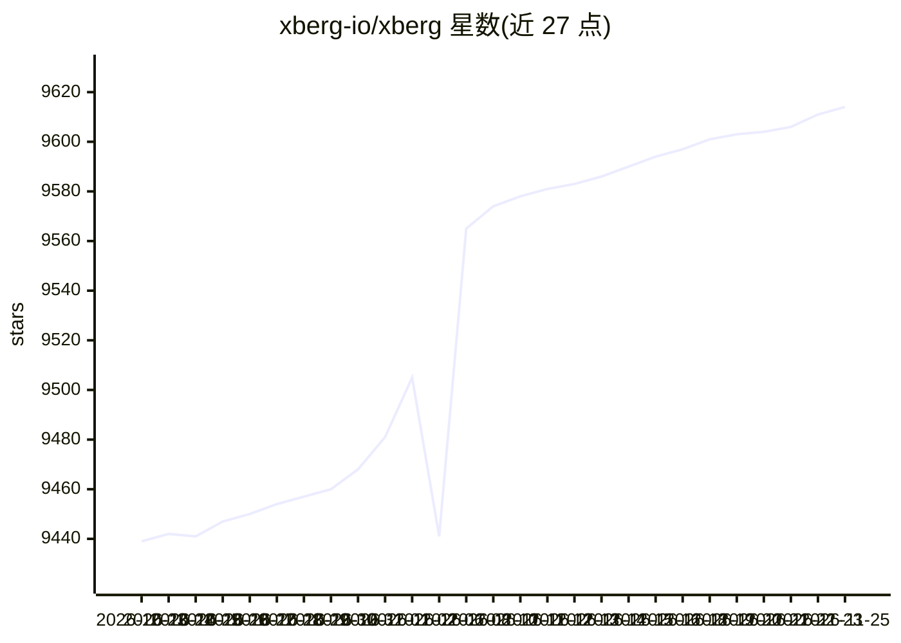

# xberg-io/xberg

⭐ 9,614 · Rust · MIT · 推送 2026-11-23 · [GitHub](https://github.com/xberg-io/xberg) · [官网](https://docs.xberg.io) · 组织维护

**多语言文档智能提取引擎：从 100+ 格式读取文本、表格与元数据**

以 Rust 为核心的文档抽取引擎，支持 107 种文档格式（141 个扩展名）、音频转录、URL 抓取与代码符号提取，输出文本/Markdown/HTML/JSON 等 6 种格式。提供 15 种语言绑定，可作为库、CLI（14 个命令）、REST API 或 MCP 服务器运行，CPU 即可运行，无需 GPU。部分能力（URL 抓取、转录、布局模型）依赖 Cargo feature flag，从源码构建时需显式启用。

## 筛选速览

| 维度 | 判定 | 备注 |
|---|---|---|
| AI 角色 | `ai-ecosystem` | LLM/agent 周边工具 |
| 许可风险 | `permissive` | MIT |
| 部署形态 | `self-host` | docker 或自建部署 |
| 模型依赖 | local-ok | 支持本地模型 |
| 硬件要求 | `cpu-ok` | |
| 安装摩擦 | `low` | 无编译、无系统依赖或容器化 |
| 成熟度 | — | 结构信号不足 |

## 能力要点

- 107 种文档格式与 371 种编程语言的提取，含 OCR 回退链与表格结构重建
- 音频/视频语音转文字，基于 Whisper ONNX（tiny 到 large-v3）
- 结构化抽取支持本地（Ollama、LM Studio、vLLM）或托管 LLM
- 以库/CLI/REST API/MCP 服务器/Docker/Helm 多形态分发

## 适用场景

- 把 PDF、扫描件、Office 文档批量转成 Markdown 供 RAG 管线使用
- 给 agent 或编程助手接入文档提取工具（MCP 服务器）
- 从音频/视频文件生成文字转录
- 解析源码树抽取函数、类与导入信息

## 场景标签

`文档解析` `OCR` `语音识别` · 领域:知识与检索

## 证据(README 行号)

> L101: Point Xberg at anything — a PDF, a spreadsheet, a scanned image, an audio file, a URL, an archive, a source tree —
> L109: |**OCR on demand**|Tesseract, PaddleOCR, Candle, or VLM backends — fallback chains, confidence scores, language au
> L116: |**Runs anywhere**|Library, CLI (14 commands), REST API (`xberg serve`), MCP server, Docker, Helm — CPU by default

## 星数曲线

2026-10-23 9,439 → 2026-11-25 9,614（+175）

---
*卡片 v1 · prompt 1.4 · 生成 2026-11-22 · 置信度 high · 依据 README sha `435ec028a07e` · [字段定义](../../DATASET.md)*
