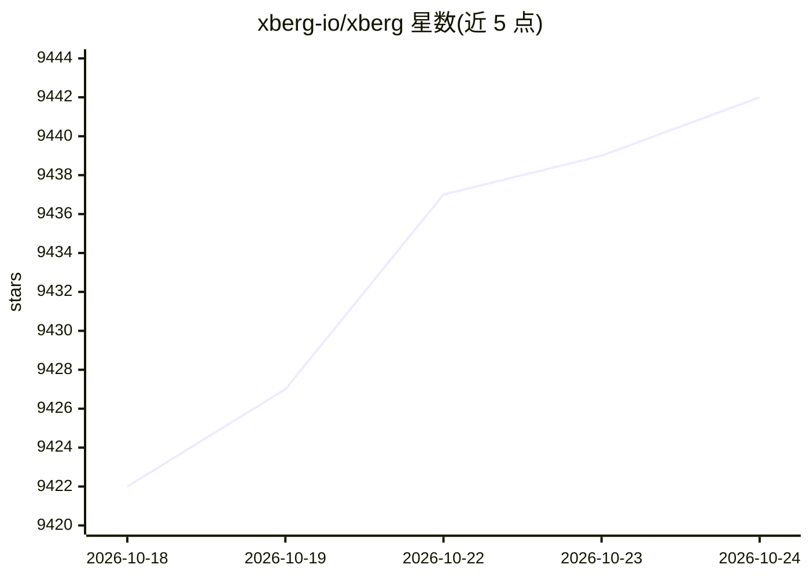

# xberg-io/xberg

⭐ 9,442 · Rust · MIT · 推送 2026-10-23 · [GitHub](https://github.com/xberg-io/xberg) · [官网](https://docs.xberg.io) · 组织维护

**Rust 文档智能引擎：从 107 种格式提取文本、表格与结构化数据**

以 Rust 为核心的多语言文档智能引擎：对 PDF、Office、图像、音频、URL、归档与源码树执行格式检测、读取、OCR 与提取，输出纯文本、Markdown、JSON 树等 6 种格式；另含 371 种语言的代码符号提取、语音转写（Whisper ONNX）、嵌入与检索、schema 驱动的结构化抽取。OCR 与转写等为可选 Cargo feature。提供 15 种语言绑定及 CLI、REST API、MCP server 三种运行形态；默认 CPU 运行，无需 GPU。自称为 Kreuzberg 的更名迭代。

## 筛选速览

| 维度 | 判定 | 备注 |
|---|---|---|
| AI 角色 | `ai-enhanced` | 去掉 AI 部分产品仍成立 |
| 许可风险 | `permissive` | MIT |
| 部署形态 | `self-host` | docker 或自建部署 |
| 模型依赖 | local-ok | 支持本地模型 |
| 硬件要求 | `cpu-ok` | |
| 安装摩擦 | `low` | 无编译、无系统依赖或容器化 |
| 成熟度 | — | 结构信号不足 |

## 能力要点

- 107 种文档格式 / 141 种扩展名的统一提取，含 MIME 检测
- OCR 多后端（Tesseract/PaddleOCR/Candle/VLM）与 ML 版面/表格重建
- 15 种语言绑定 + CLI（14 命令）+ REST API + MCP server（9 工具）
- Docker/Helm 部署，默认 CPU 运行，内容哈希缓存与并行批处理

## 适用场景

- 为 RAG 管道批量把 PDF/Office 文档转为 Markdown 或结构化文本
- 通过 MCP 让 Claude Desktop 或 Cursor 等助手调用文档提取能力
- 递归处理 zip/tar 等归档中的嵌套文档并做格式检测

## 场景标签

`文档解析` `OCR` · 领域:知识与检索

## 证据(README 行号)

> L89: Point Xberg at anything — a PDF, a scanned image, a spreadsheet, an audio file, a URL, a whole archive, or a source
> L109: |**OCR on demand**|Tesseract, PaddleOCR, Candle, or VLM backends — fallback chains, confidence scores, language au
> L116: |**Runs anywhere**|Library, CLI (14 commands), REST API (`xberg serve`), MCP server, Docker, Helm — CPU by default

## 星数曲线

2026-10-18 9,422 → 2026-10-24 9,442（+20）

---
*卡片 v1 · prompt 1.4 · 生成 2026-10-20 · 置信度 mid · 依据 README sha `b5f47eef582f` · [字段定义](../../DATASET.md)*
