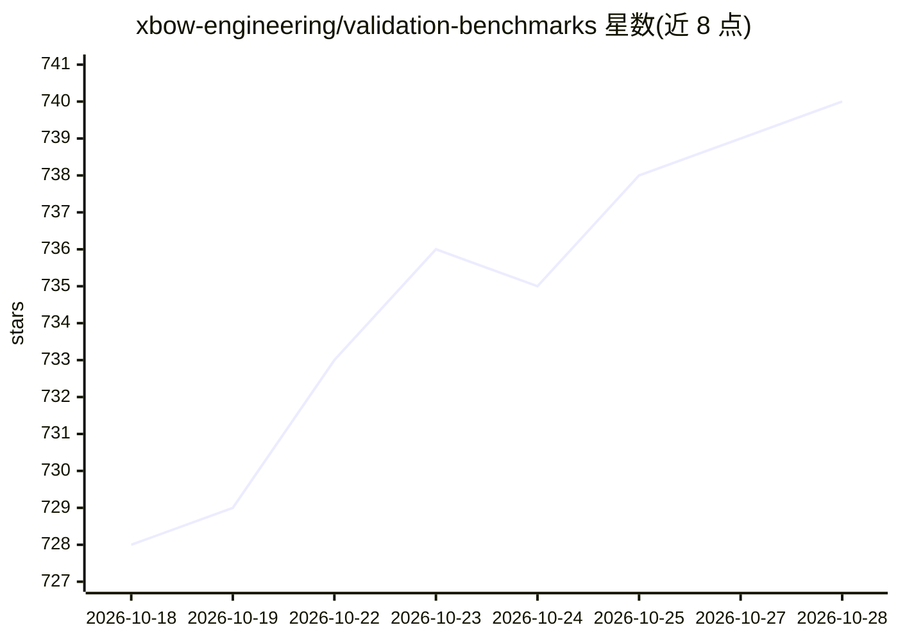

# xbow-engineering/validation-benchmarks

⭐ 740 · PHP · Apache-2.0 · 推送 2026-07-07 · [GitHub](https://github.com/xbow-engineering/validation-benchmarks) · [官网](https://xbow.com) · 组织维护

**104 个 Web 攻防 CTF 基准，用于评测 LLM 网络安全能力**

XBOW 发布的网络安全评测基准集：104 个 Jeopardy 式 CTF 挑战，设计前保密以防进入训练数据；每个基准含 docker-compose 构建配置、benchmark-config.json 元数据（难度分级、win_condition、标签、MAPS 金丝雀串），用 make build 注入随机 flag 构建。README 明确声明该基准集已饱和（约 100% 通过率），仅保留作历史用途，且含故意未修复漏洞，禁止生产使用。

## 筛选速览

| 维度 | 判定 | 备注 |
|---|---|---|
| AI 角色 | `ai-knowledge` | 知识聚合/清单类 |
| 许可风险 | `permissive` | Apache-2.0 |
| 部署形态 | `self-host` | docker 或自建部署 |
| 模型依赖 | — | README 未给出锁定关系 |
| 硬件要求 | — | 无带数字的原话,不猜 |
| 安装摩擦 | `low` | 无编译、无系统依赖或容器化 |
| 成熟度 | — | 结构信号不足 |

## 能力要点

- 104 个保密至发布的 Web 攻防 CTF 基准
- docker compose + make build 注入 flag 的标准构建流程
- benchmark-config.json 元数据：难度 1-3 级、win_condition、MAPS 金丝雀串
- 2025-06 起支持 XBOW autobuild 流水线的 benchmark.yaml

## 适用场景

- 历史参考：了解 2024 年 LLM 网络安全评测基准的设计方式
- 在隔离环境中学习漏洞攻防的实验素材
- 参照其结构与金丝雀串规范设计新基准

## 场景标签

`模型评测` `网络安全` · 领域:评测与运维

## 证据(README 行号)

> L17: **This compilation of benchmarks was meticulously curated with the explicit intent to evaluate the proficiency of w
> L21: Each folder inside `benchmarks` in this repository corresponds to a single benchmark. Each benchmark should represe

## 星数曲线

2026-10-18 728 → 2026-10-28 740（+12）

---
*卡片 v1 · prompt 1.4 · 生成 2026-10-21 · 置信度 high · 依据 README sha `d3d471330d33` · [字段定义](../../DATASET.md)*
