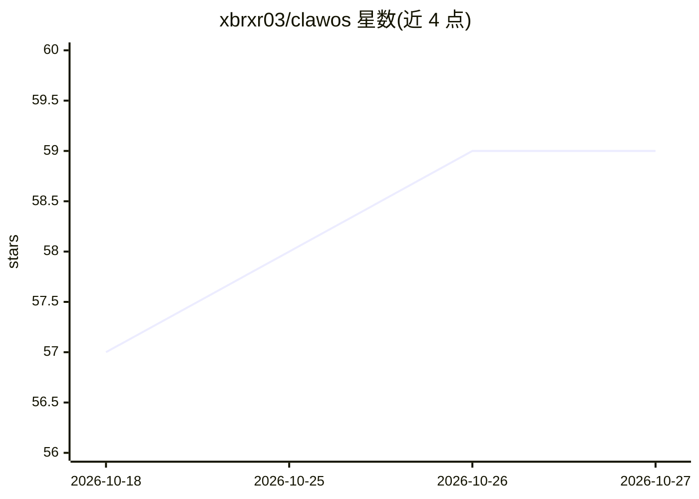

# xbrxr03/clawos

⭐ 59 · Python · AGPL-3.0 · 推送 2026-06-30 · [GitHub](https://github.com/xbrxr03/clawos) · [官网](https://github.com/xbrxr03/clawos) · 个人维护

**本地运行的开源个人 AI agent 系统：语音激活、多步工具执行与记忆**

面向个人笔记本用户的本地 AI agent 系统，完全离线运行，无云端、无 API key、无遥测。功能包括："Hey Claw" 唤醒词语音交互（Whisper STT + Piper TTS）、31 个内置工具与 29 个内置工作流的多步任务执行、7 层记忆（向量检索、FTS5、知识图谱等）、多 agent 协作（A2A）、带引用的多源深度研究、模型对比评测，以及笔记/日历/邮件套件。通过 policyd 守护进程实现敏感操作的人工审批弹窗。模型后端可选 Ollama 或 OpenAI 兼容 API，最低 8GB RAM，提供安装脚本、源码安装与可启动 ISO。

## 筛选速览

| 维度 | 判定 | 备注 |
|---|---|---|
| AI 角色 | `ai-native` | 本体是模型或模型工具 |
| 许可风险 | `viral` | AGPL-3.0 |
| 部署形态 | `library` | 以包/库形式分发 |
| 模型依赖 | local-ok | 支持本地模型 |
| 硬件要求 | — | 无带数字的原话,不猜 |
| 安装摩擦 | `low` | 无编译、无系统依赖或容器化 |
| 成熟度 | — | 结构信号不足 |

## 能力要点

- 语音唤醒 + 本地 STT/TTS 的全离线语音交互
- 31 个工具与 29 个工作流，支持多步链式执行
- 7 层记忆：置顶事实、向量检索、全文检索、知识图谱、归档、自纠错、工作流状态
- 敏感操作原生审批弹窗 + Merkle 审计日志 + 工作区沙箱

## 适用场景

- 在旧笔记本上刷入 ISO 搭建个人 JARVIS 式助手
- 语音唤醒后听晨间简报（日程、天气、提醒）
- 让 agent 自动整理下载文件夹等多步任务并在敏感操作前人工确认
- 本地跑模型做深度研究并追踪引用来源

## 场景标签

`语音 Agent` `AI 助手` · 领域:对话与助手

## 证据(README 行号)

> L5: The JARVIS-style AI agent that runs 100% on your hardware —
> L121: - **Wake word**: "Hey Claw" activates listening — no button needed
> L133: - **Native function calling**: qwen2.5 with Ollama-native tool use

## 星数曲线

2026-10-18 57 → 2026-10-27 59（+2）

---
*卡片 v1 · prompt 1.4 · 生成 2026-10-24 · 置信度 high · 依据 README sha `602f354e350e` · [字段定义](../../DATASET.md)*
