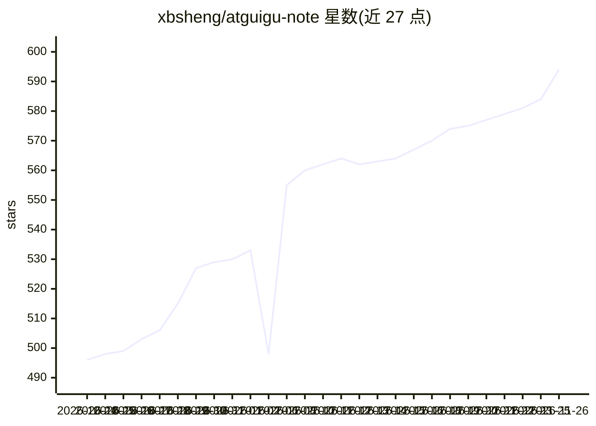

# xbsheng/atguigu-note

⭐ 594 · Jupyter Notebook · 推送 2026-11-25 · [GitHub](https://github.com/xbsheng/atguigu-note) · [官网](https://xbsheng.github.io/atguigu-note/) · 个人维护 · 中文 README

**面向学习者的 AI 课程配套课件与代码笔记站**

尚硅谷系列 AI 课程的配套资料整理仓库，覆盖 Python 入门到进阶、LangChain 1.2 入门与 Agent/RAG 实战、LangGraph 智能体部署、Vibe Coding（Claude Code/Skills/Codex）以及企业级 Agent 应用与 Skills 开发等五门课程。以 VitePress 构建在线文档站点，站点直接复用各课程目录下的课件 Markdown，并提供 B 站视频链接与 Notebook 在线跟练入口。仓库声明仅供学习交流使用。

## 筛选速览

| 维度 | 判定 | 备注 |
|---|---|---|
| AI 角色 | `ai-knowledge` | 知识聚合/清单类 |
| 许可风险 | `none` | — |
| 部署形态 | `library` | 以包/库形式分发 |
| 模型依赖 | — | README 未给出锁定关系 |
| 硬件要求 | — | 无带数字的原话,不猜 |
| 安装摩擦 | `low` | 无编译、无系统依赖或容器化 |
| 成熟度 | — | 结构信号不足 |

## 能力要点

- 五门 AI 课程（Python/LangChain/LangGraph/AI Coding/Agent Skills）的课件与代码整理
- VitePress 在线站点，直接复用课程目录下的课件 Markdown
- 提供 B 站课程视频链接与浏览器内 Notebook 跟练页面

## 适用场景

- 按分 P 观看 B 站课程后对照课件复习笔记
- 在浏览器中打开配套 Notebook 跟练 LangChain/LangGraph 内容
- 按技术篇到实战篇顺序练习企业级 Agent 应用开发

## 场景标签

`教程课程` · 领域:学习与行业

## 证据(README 行号)

> L8: Python / LangChain / LangGraph / AI Coding / Agent Skills 课程配套课件与代码整理
> L21: ## 课程目录

## 星数曲线

2026-10-24 496 → 2026-11-26 594（+98）

---
*卡片 v1 · prompt 1.4 · 生成 2026-11-25 · 置信度 mid · 依据 README sha `d2bc46d4f85f` · [字段定义](../../DATASET.md)*
