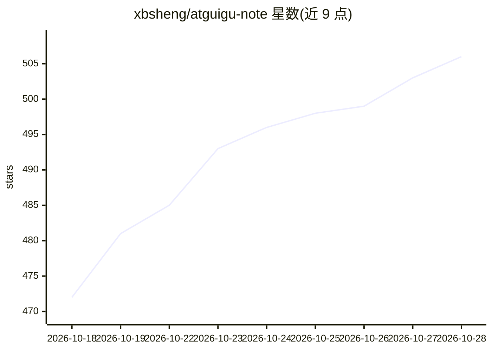

# xbsheng/atguigu-note

⭐ 506 · Jupyter Notebook · 推送 2026-10-27 · [GitHub](https://github.com/xbsheng/atguigu-note) · [官网](https://xbsheng.github.io/atguigu-note/) · 个人维护 · 中文 README

**尚硅谷 Python/LangChain/LangGraph/AI Coding 课程配套课件与代码整理**

个人维护的课程笔记仓库：整理尚硅谷 Python 零基础、LangChain 1.2（Agent/RAG 实战）、LangGraph（智能体部署）与 Vibe Coding（Claude Code/Skills/Codex）四门课程的课件 Markdown 与配套代码，用 VitePress 构建在线站点（GitHub Pages 部署），直接复用各课程下的课件文件，支持浏览器内在线阅读 Notebook。课程版权归尚硅谷所有，仓库仅供学习交流。

## 筛选速览

| 维度 | 判定 | 备注 |
|---|---|---|
| AI 角色 | `ai-knowledge` | 知识聚合/清单类 |
| 许可风险 | `none` | — |
| 部署形态 | `library` | 以包/库形式分发 |
| 模型依赖 | — | README 未给出锁定关系 |
| 硬件要求 | — | 无带数字的原话,不猜 |
| 安装摩擦 | `low` | 无编译、无系统依赖或容器化 |
| 成熟度 | — | 结构信号不足 |

## 能力要点

- 覆盖 Python/LangChain/LangGraph/AI Coding 四门课程课件与代码
- VitePress 在线站点，GitHub Pages 部署
- LangChain/LangGraph 配套 Notebook 支持浏览器在线阅读

## 适用场景

- 学习尚硅谷 LangChain/LangGraph 课程时对照课件复习
- 在浏览器中直接跟练配套 Notebook
- 查找 Vibe Coding（Claude Code/Codex）实战项目代码

## 场景标签

`教程课程` · 领域:学习与行业

## 证据(README 行号)

> L8: 尚硅谷 Python / LangChain / LangGraph / AI Coding 课程配套课件与代码整理
> L26: |LangChain|LangChain 1.2 入门到 Agent / RAG 实战|BV1rv7A6oEeP|README|
> L27: |LangGraph|LangGraph 入门到智能体部署实战|BV1z3NY66EY1|README|

## 星数曲线

2026-10-18 472 → 2026-10-28 506（+34）

---
*卡片 v1 · prompt 1.4 · 生成 2026-10-21 · 置信度 high · 依据 README sha `b4b6b9867110` · [字段定义](../../DATASET.md)*
