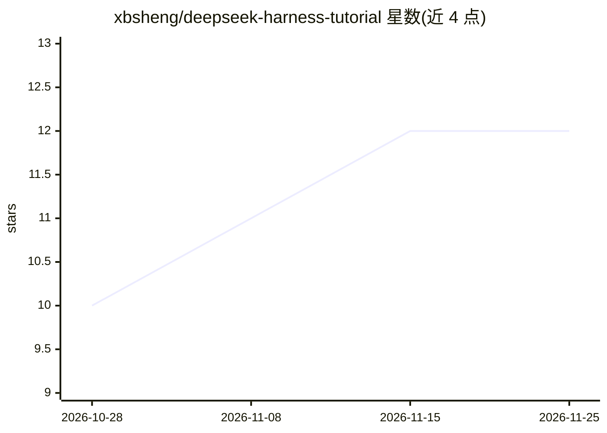

# xbsheng/deepseek-harness-tutorial

⭐ 12 · TypeScript · 推送 2026-08-17 · [GitHub](https://github.com/xbsheng/deepseek-harness-tutorial) · [官网](https://xbsheng.github.io/deepseek-harness-tutorial/) · 个人维护 · 中文 README

**从零实现 DeepSeek Harness 的中文智能体框架教程**

基于开源的 deepseek-ai/deepseek-harness 项目的独立中文教学项目，带领读者从零实现一个包含核心功能的简易版智能体框架 mini-dsh（TypeScript、零运行时依赖）。内容覆盖插件系统、会话事件日志、LLM 适配器、工具系统、Agent 循环、示例插件、CLI 与测试等 11 章，配套 VitePress 教程站（中文默认 + 英文版）与 25 个测试。仓库声明与 DeepSeek 官方无隶属关系，mini-dsh 为概念同构的简化实现而非官方代码搬运。

## 筛选速览

| 维度 | 判定 | 备注 |
|---|---|---|
| AI 角色 | `ai-knowledge` | 知识聚合/清单类 |
| 许可风险 | `none` | — |
| 部署形态 | `library` | 以包/库形式分发 |
| 模型依赖 | — | README 未给出锁定关系 |
| 硬件要求 | — | 无带数字的原话,不猜 |
| 安装摩擦 | `low` | 无编译、无系统依赖或容器化 |
| 成熟度 | — | 结构信号不足 |

## 能力要点

- 11 章教程覆盖插件系统、会话日志、LLM 缝隙、工具系统、Agent 循环
- mini-dsh 为 TypeScript 实现，零运行时依赖，附 25 个测试
- VitePress 教程站提供中文默认与 /en/ 英文双语版本
- 附录提供与官方架构的对照说明

## 适用场景

- 想从零理解智能体框架（agent harness）内部机制的学习者
- 寻找 DeepSeek Harness 中文教程资料的 TypeScript 开发者
- 参考简易实现自行构建插件化 Agent 框架

## 场景标签

`教程课程` `Agent 框架` · 领域:Agent 开发

## 证据(README 行号)

> L5: 基于最新开源的 `deepseek-ai/deepseek-harness`(2026-08-13 开源,MIT),从零到一实现一个包含核心功能的**简易版智能体框架** —— **mini-dsh** 的完整中文教程。
> L12: ├── docs/          # VitePress 教程站(中文默认 + /en/ 英文版,11 章 + 附录)
> L44: 本仓库是**独立教学项目**,与 DeepSeek 官方无隶属关系。`mini-dsh` 是「概念同构的简化实现」,并非官方代码的搬运。

## 星数曲线

2026-10-28 10 → 2026-11-25 12（+2）

---
*卡片 v1 · prompt 1.4 · 生成 2026-11-18 · 置信度 mid · 依据 README sha `d690e6d6c834` · [字段定义](../../DATASET.md)*
