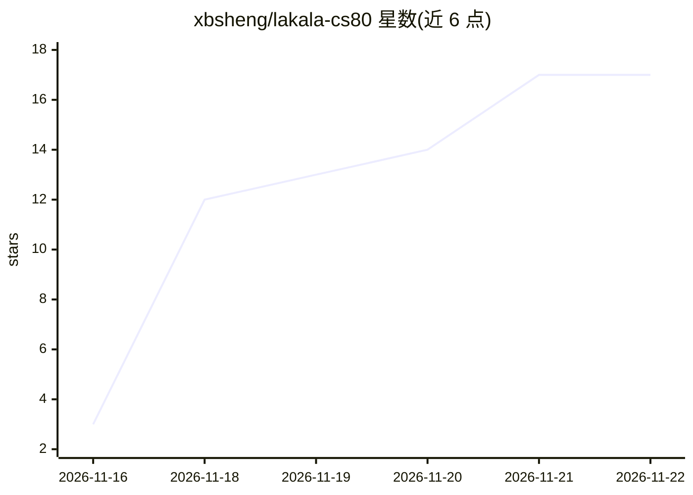

# xbsheng/lakala-cs80

⭐ 17 · Python · 推送 2026-11-17 · [GitHub](https://github.com/xbsheng/lakala-cs80) · 个人维护 · 中文 README

**把拉卡拉 CS80 客显屏改造成本地副屏，显示画布与 Agent 状态**

针对拉卡拉 CS80 客显屏（¥39 设备）的固件改造项目：只刷固件不改硬件，把设备变成 800×1280 副屏。一条 QDC1 协议链路全本地运行：host.py 将浏览器画布像素按 tile 差分推给 C 编译的 sidecar，LZ4 压缩后经 USB 写屏。功能包括多画布拖拽编辑器、自定义 ES 模块页面、视频屏保、本地音频播放，以及自动扫描本机 Pi/Claude Code/Codex/DeepSeek Harness 会话的 Agent 状态组件。刷机仅限 Windows 10/11；运行端支持 macOS/Windows/Linux，无云依赖。

## 筛选速览

| 维度 | 判定 | 备注 |
|---|---|---|
| AI 角色 | `ai-enhanced` | 去掉 AI 部分产品仍成立 |
| 许可风险 | `none` | — |
| 部署形态 | `desktop` | 安装包/桌面程序 |
| 模型依赖 | — | README 未给出锁定关系 |
| 硬件要求 | — | 无带数字的原话,不猜 |
| 安装摩擦 | `high` | 编译与系统依赖俱全 |
| 成熟度 | — | 结构信号不足 |

## 能力要点

- 一键刷机脚本自动识别固件代次（R03/R05）并选择刷写路径
- 5×8 网格拖拽画布，含时钟、股票、天气、Home Assistant 概览等组件
- Agent 状态组件扫描本机 Pi/Claude Code/Codex/DeepSeek Harness 会话
- 每帧 VERIFY 回读 framebuffer 哈希自检，刷前整片备份原厂固件

## 适用场景

- 把手头拉卡拉 CS80 屏改造成桌面状态副屏
- 在副屏上监控本机多个 AI 编程 Agent 的会话状态
- 搭建本地 Home Assistant 全屋概览小屏

## 场景标签

`编码 Agent` · 领域:编码与开发

## 证据(README 行号)

> L3: 一台 ¥39 的「拉卡拉客显屏 CS80」，**不改硬件**（原屏、原主板、原 Type-C/12V 供电，只刷固件），
> L10: 一份 canvas 渲染代码同时是编辑器、预览和设备像素源：`host.py` 把浏览器算出来的像素
> L21: |Agent 状态|自动扫描本机 Pi / Claude Code / Codex / DeepSeek Harness 的会话，列表按「运行中 → 等待 → 结束」排序，可逐条隐藏|

## 星数曲线

2026-11-16 3 → 2026-11-22 17（+14）

---
*卡片 v1 · prompt 1.4 · 生成 2026-11-18 · 置信度 mid · 依据 README sha `2aa3ec113fe5` · [字段定义](../../DATASET.md)*
