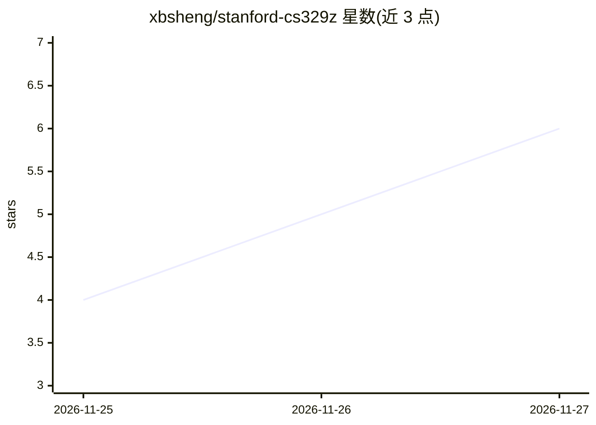

# xbsheng/stanford-cs329z

⭐ 6 · JavaScript · 推送 2026-10-27 · [GitHub](https://github.com/xbsheng/stanford-cs329z) · [官网](https://xbsheng.github.io/stanford-cs329z/) · 个人维护 · 中文 README

**斯坦福 CS329Z agent 工程课程的中文讲义站点**

对斯坦福 CS329Z《Engineering AI Agents》（2026 秋）公开课程材料的中文二次整理，以 VitePress 建站并提供在线阅读。已覆盖已发布 slides 的全部 10 讲，主题包括 RAG、工具调用、框架编排、agent 记忆、多智能体与优化等；每讲附 5 分钟速读卡、50 分钟学习路线、系统栈与跨讲对照表，站点可在「详细讲义」与「精华版」两种版本间切换。README 声明不替代原始课件，公式与引用以 slides 为准，材料版权归 Stanford 及讲者所有，讲义由 AI 辅助整理。

## 筛选速览

| 维度 | 判定 | 备注 |
|---|---|---|
| AI 角色 | `ai-knowledge` | 知识聚合/清单类 |
| 许可风险 | `none` | — |
| 部署形态 | `None` |  |
| 模型依赖 | — | README 未给出锁定关系 |
| 硬件要求 | — | 无带数字的原话,不猜 |
| 安装摩擦 | `low` | 无编译、无系统依赖或容器化 |
| 成熟度 | — | 结构信号不足 |

## 能力要点

- 覆盖已发布 slides 的全部 10 讲中文讲义
- 每讲附 5 分钟速读卡与 50 分钟学习路线
- 详细讲义与精华版页面一一对应、可切换
- VitePress 静态站点，提供 GitHub Pages 在线阅读

## 适用场景

- 学习中英文对照阅读 agent 工程课程内容
- 按速读卡快速回顾各讲要点
- 规划 agent 课程的系统学习路线

## 场景标签

`教程课程` · 领域:学习与行业

## 证据(README 行号)

> L1: # 斯坦福 CS329Z · Engineering AI Agents（2026 秋）中文讲义
> L70: - 本站是课程公开材料的中文二次整理，不替代原始课件；公式、数字与引用以 slides 为准。

## 星数曲线

2026-11-25 4 → 2026-11-27 6（+2）

---
*卡片 v1 · prompt 1.4 · 生成 2026-11-24 · 置信度 high · 依据 README sha `c9f4ba2a557c` · [字段定义](../../DATASET.md)*
