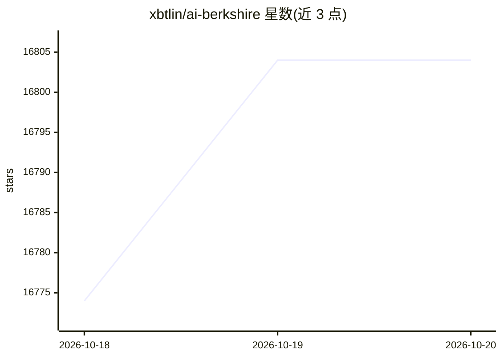

# xbtlin/ai-berkshire

⭐ 16,804 · HTML · MIT · 推送 2026-10-19 · [GitHub](https://github.com/xbtlin/ai-berkshire) · [官网](https://xbtlin.github.io/ai-berkshire/) · 个人维护 · 中文 README

**给个人投资者的 Claude Code/Codex 价值投研 Skill 框架**

一套可装入 Claude Code 与 Codex 的投资研究 Skill 合集（20 个入口），将四位价值投资者的方法论结构化为可执行流程，覆盖个股深度研究、财报精读、行业筛选、持仓管理。核心机制包括：Team Lead 并行调度 4 个大师视角 Agent 独立研究后综合、强制输出通过/不通过/灰色地带结论、A/B/C 信息丰富度评级与快速否决清单、Python decimal 精确计算与多源数据交叉验证。安装依赖先装 Claude Code 或 Codex 客户端，再克隆仓库运行脚本复制 skills。README 含实盘收益宣传，属维护者自述。

## 筛选速览

| 维度 | 判定 | 备注 |
|---|---|---|
| AI 角色 | `ai-native` | 本体是模型或模型工具 |
| 许可风险 | `permissive` | MIT |
| 部署形态 | `library` | 以包/库形式分发 |
| 模型依赖 | locked-api |  |
| 硬件要求 | — | 无带数字的原话,不猜 |
| 安装摩擦 | `low` | 无编译、无系统依赖或容器化 |
| 成熟度 | — | 结构信号不足 |

## 动量与使用信号

- 维护:`active` — 距上次 push 0.7 天,年发版 1,14 位贡献者
- 涨星:近 1 天 **+18**(自 20261016 起算)
- 安装:npm 包 `@anthropic-ai/claude-code` 月下载 51,887,565

## 能力要点

- 20 个 Skill 入口：深度研究、财报分析、行业筛选、持仓管理、思维工具
- /investment-team 启动 4 个独立 Agent 并行研究，Team Lead 综合
- 数据用 Python decimal 精确计算，关键数据至少 2 个独立来源交叉验证
- 同时维护 Claude Code commands 与 Codex skills 两套入口及同步脚本

## 适用场景

- 用四大师多视角框架研究一家上市公司是否值得投资
- 从全市场逐层漏斗筛选出 3 家深度分析标的
- 财报发布后用一手资料精读并跟踪投资论文是否被证伪

## 场景标签

`金融量化` · 领域:学习与行业

## 证据(README 行号)

> L11: **AI Berkshire** 是一套同时兼容 Claude Code 与 Codex 的投资研究 Skill 合集，将巴菲特、芒格、段永平、李录四位价值投资大师的方法论系统化、结构化，通过 AI Agent 实现专业级投资研究
> L158: - **Skill 层**：把"你要做什么"抽象成 20 个明确入口——深度研究、财报分析、行业筛选、持仓管理、思维工具，按场景选用
> L232: ```bash

## 星数曲线



2026-10-18 16,774 → 2026-10-20 16,804（+30）


---
*卡片 v1 · prompt 1.4 · 生成 2026-10-18 · 置信度 mid · 依据 README sha `7b186af80430` · [字段定义](../../DATASET.md)*
