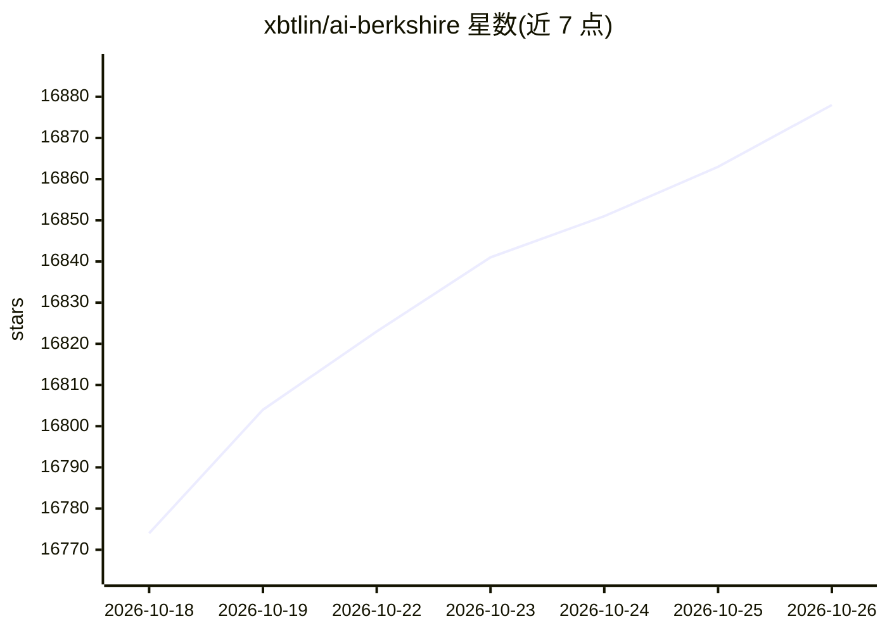

# xbtlin/ai-berkshire

⭐ 16,878 · HTML · MIT · 推送 2026-10-24 · [GitHub](https://github.com/xbtlin/ai-berkshire) · [官网](https://xbtlin.github.io/ai-berkshire/) · 个人维护 · 中文 README

**给个人投资者的 Claude Code/Codex 价值投研 Skill 合集**

同时兼容 Claude Code 与 Codex 的投资研究 Skill 合集：将巴菲特、芒格、段永平、李录四位投资人的方法论结构化为 22 个 skill，覆盖深度研究、财报精读、行业筛选、持仓管理与思维工具。团队型 skill（如 /investment-team）由 Team Lead 调度 4 个 Agent 并行研究并综合研判；流程内置信息丰富度评级、逆向检验、多源数据交叉验证等机制，金融计算用 Python decimal.Decimal 精确处理。安装方式为克隆仓库后运行脚本将 skills 复制进客户端；附 2247 份报告存档与阅读站，深度研究 token 消耗较高。

## 筛选速览

| 维度 | 判定 | 备注 |
|---|---|---|
| AI 角色 | `ai-native` | 本体是模型或模型工具 |
| 许可风险 | `permissive` | MIT |
| 部署形态 | `library` | 以包/库形式分发 |
| 模型依赖 | locked-api |  |
| 硬件要求 | — | 无带数字的原话,不猜 |
| 安装摩擦 | `low` | 无编译、无系统依赖或容器化 |
| 成熟度 | — | 结构信号不足 |

## 动量与使用信号

- 维护:`active` — 距上次 push 0.7 天,年发版 1,14 位贡献者
- 涨星:近 1 天 **+18**(自 20261016 起算)
- 安装:npm 包 `@anthropic-ai/claude-code` 月下载 51,887,565

## 能力要点

- 22 个 skill：深度研究/财报分析/行业筛选/持仓管理/思维工具五类
- /investment-team 启动 4 个 Agent 并行研究、互相挑战后由 Team Lead 综合
- 反偏见机制：A/B/C 信息丰富度评级、芒格逆向检验、快速否决清单、多源交叉验证
- 同一套 canonical workflow 同时提供 Claude Code commands 与 Codex skills

## 适用场景

- 在 Claude Code/Codex 里对一家上市公司做多视角深度投研
- 用行业漏斗从全市场逐层筛选出候选公司
- 买入后持续追踪投资论文是否被证伪
- 财报季只读一手原始财报做精读分析

## 场景标签

`金融量化` `多智能体` · 领域:Agent 开发

## 证据(README 行号)

> L11: **AI Berkshire** 是一套同时兼容 Claude Code 与 Codex 的投资研究 Skill 合集，将巴菲特、芒格、段永平、李录四位价值投资大师的方法论系统化、结构化，通过 AI Agent 实现专业级投资研究
> L163: - **Agent 层**：团队型 skill（如 `/investment-team`、`/earnings-team`）由 Team Lead 并行调度 4 个大师视角 Agent——各自独立搜索、独立判断、互相挑战，最后综
> L307: 仓库同时维护三套入口：`skills/*.md` 是 Claude Code command 源文件；`codex-skills/*/SKILL.md` 是 Codex skill 包，由 `scripts/sync-codex

## 星数曲线

2026-10-18 16,774 → 2026-10-26 16,878（+104）

---
*卡片 v1 · prompt 1.4 · 生成 2026-10-20 · 置信度 mid · 依据 README sha `6718ed6064d2` · [字段定义](../../DATASET.md)*
