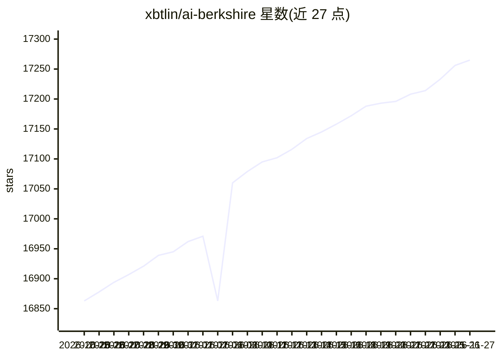

# xbtlin/ai-berkshire

⭐ 17,265 · HTML · MIT · 推送 2026-11-25 · [GitHub](https://github.com/xbtlin/ai-berkshire) · [官网](https://xbtlin.github.io/ai-berkshire/) · 个人维护 · 中文 README

**给个人投资者的 Claude Code/Codex 价值投研 Skill 合集**

一套同时兼容 Claude Code 与 Codex 的投资研究 Skill 合集，将巴菲特、芒格、段永平、李录四位价值投资大师的方法论结构化为 22 个入口，覆盖深度研究、财报分析、行业筛选、持仓管理与思维工具五类。团队型 skill 由 Team Lead 并行调度 4 个大师视角 Agent 独立搜索与评分，内置快速否决清单、芒格式逆向检验、多源数据交叉验证（Python decimal 精确计算）与信息丰富度评级等反偏见机制。需先安装 Claude Code 或 Codex 客户端，再克隆仓库运行安装脚本；维护者声明深度研究类 skill token 消耗较高。

## 筛选速览

| 维度 | 判定 | 备注 |
|---|---|---|
| AI 角色 | `ai-native` | 本体是模型或模型工具 |
| 许可风险 | `permissive` | MIT |
| 部署形态 | `library` | 以包/库形式分发 |
| 模型依赖 | locked-api |  |
| 硬件要求 | — | 无带数字的原话,不猜 |
| 安装摩擦 | `low` | 无编译、无系统依赖或容器化 |
| 成熟度 | — | 结构信号不足 |

## 动量与使用信号

- 维护:`active` — 距上次 push 0.7 天,年发版 1,14 位贡献者
- 涨星:近 1 天 **+18**(自 20261016 起算)
- 安装:npm 包 `@anthropic-ai/claude-code` 月下载 51,887,565

## 能力要点

- 22 个 Skill 覆盖深度研究/财报/行业筛选/持仓管理/思维工具
- /investment-team 并行调度 4 个大师视角 Agent 独立研究后综合
- 8 条红线快速否决清单与芒格式逆向检验等反偏见机制
- 财务计算使用 Python decimal 精确十进制并要求至少 2 个独立来源交叉验证

## 适用场景

- 对一家上市公司做四大师视角的深度投资研究
- 财报发布后精读原始年报并交叉验证关键数据
- 从一个行业主题出发逐层漏斗筛选个股
- 跟踪持仓投资论文是否被证伪

## 场景标签

`金融量化` · 领域:学习与行业

## 证据(README 行号)

> L11: **AI Berkshire** 是一套同时兼容 Claude Code 与 Codex 的投资研究 Skill 合集，将巴菲特、芒格、段永平、李录四位价值投资大师的方法论系统化、结构化，通过 AI Agent 实现专业级投资研究
> L164: - **Skill 层**：把"你要做什么"抽象成 22 个明确入口——深度研究、财报分析、行业筛选、持仓管理、思维工具，按场景选用
> L226: ### 成本与模型选择

## 星数曲线

2026-10-25 16,863 → 2026-11-27 17,265（+402）

---
*卡片 v1 · prompt 1.4 · 生成 2026-11-26 · 置信度 mid · 依据 README sha `bbe25fa0349d` · [字段定义](../../DATASET.md)*
