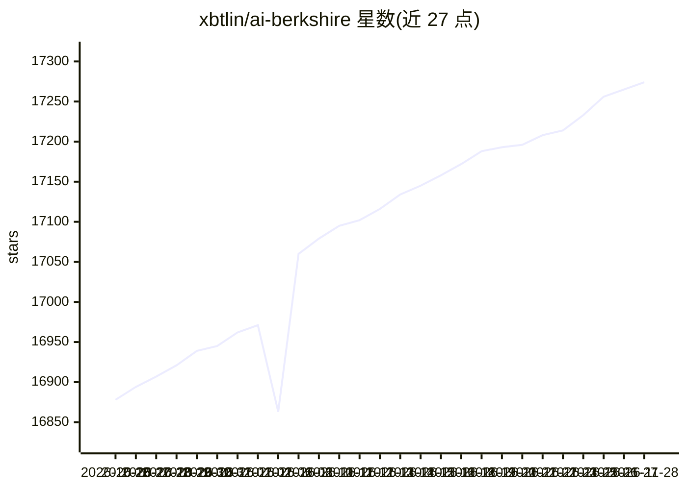

# xbtlin/ai-berkshire

⭐ 17,274 · HTML · MIT · 推送 2026-11-27 · [GitHub](https://github.com/xbtlin/ai-berkshire) · [官网](https://xbtlin.github.io/ai-berkshire/) · 个人维护 · 中文 README

**面向个人投资者的 Claude Code/Codex 价值投研 Skill 合集**

一套同时兼容 Claude Code 与 Codex 的投资研究 Skill 合集（22 个入口），将巴菲特、芒格、段永平、李录四人的方法论结构化为可执行流程，覆盖深度研究、财报分析、行业筛选、持仓管理与思维工具五类。核心机制包括：多 Agent 并行研究（Team Lead 调度 4 个大师视角 Agent）、信息丰富度评级、芒格式逆向检验、快速否决清单、财务数据多源交叉验证与手算校验脚本。依赖 npm 安装的 Claude Code 或 curl 脚本安装的 Codex，仓库提供各平台的克隆安装脚本；README 另附作者实盘收益记录与公众号、阅读站等渠道声明。

## 筛选速览

| 维度 | 判定 | 备注 |
|---|---|---|
| AI 角色 | `ai-native` | 本体是模型或模型工具 |
| 许可风险 | `permissive` | MIT |
| 部署形态 | `library` | 以包/库形式分发 |
| 模型依赖 | — | README 未给出锁定关系 |
| 硬件要求 | — | 无带数字的原话,不猜 |
| 安装摩擦 | `low` | 无编译、无系统依赖或容器化 |
| 成熟度 | — | 结构信号不足 |

## 动量与使用信号

- 维护:`active` — 距上次 push 0.7 天,年发版 1,14 位贡献者
- 涨星:近 1 天 **+18**(自 20261016 起算)
- 安装:npm 包 `@anthropic-ai/claude-code` 月下载 51,887,565

## 能力要点

- 22 个 Skill 入口，覆盖深度研究/财报/行业筛选/持仓管理/思维工具
- /investment-team 以 4 个并行 Agent 独立搜索与打分后综合研判
- 财务计算用 decimal.Decimal 并要求至少 2 个独立来源交叉验证
- 同一 workflow 提供 Claude Code commands 与 Codex skills 两套入口

## 适用场景

- 对一家上市公司跑四大师视角的深度投资研究
- 财报发布后用多 Agent 团队精读原始年报
- 从一个行业主题全市场漏斗筛选到 3 家标的
- 跟踪持仓投资论文是否被后续事实证伪

## 场景标签

`金融量化` · 领域:学习与行业

## 证据(README 行号)

> L11: **AI Berkshire** 是一套同时兼容 Claude Code 与 Codex 的投资研究 Skill 合集，将巴菲特、芒格、段永平、李录四位价值投资大师的方法论系统化、结构化，通过 AI Agent 实现专业级投资研究
> L164: - **Skill 层**：把"你要做什么"抽象成 22 个明确入口——深度研究、财报分析、行业筛选、持仓管理、思维工具，按场景选用
> L149: `/investment-team` 启动4个独立Agent**同时**研究一家公司。每个Agent各自搜索网络、交叉验证数据、独立给出结论。这不是把一个prompt拆成四段——是4个"分析师"各自做了完整的研究，Team Le

## 星数曲线

2026-10-26 16,878 → 2026-11-28 17,274（+396）

---
*卡片 v1 · prompt 1.4 · 生成 2026-11-28 · 置信度 high · 依据 README sha `32b7ed132aba` · [字段定义](../../DATASET.md)*
