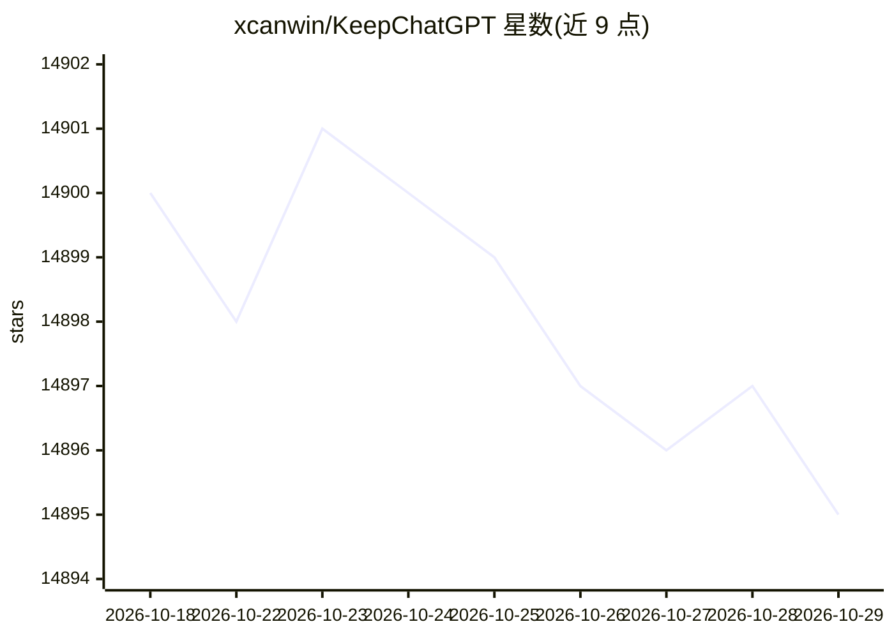

# xcanwin/KeepChatGPT

⭐ 14,895 · JavaScript · GPL-2.0 · 推送 2026-07-20 · [GitHub](https://github.com/xcanwin/KeepChatGPT) · 个人维护 · 中文 README

**为 ChatGPT 用户提供保持活跃、数据脱敏等增强功能的浏览器插件**

以 UserScript（Tampermonkey 脚本）形式分发的 ChatGPT 网页增强插件，通过 Tampermonkey 安装，支持电脑系统与移动系统（鸿蒙、iOS、Android）。功能包括定时保活请求以减少网络报错、敏感信息脱敏（按用户自定义正则规则）、拦截跟踪请求、克隆对话、取消审计提示、净化页面、展示大屏、言无不尽、侧边栏增强等。提供 npm 依赖安装与开发调试流程；README 提示谷歌/微软应用商店存在非作者上传的付费版本。

## 筛选速览

| 维度 | 判定 | 备注 |
|---|---|---|
| AI 角色 | `ai-ecosystem` | LLM/agent 周边工具 |
| 许可风险 | `viral` | GPL-2.0 |
| 部署形态 | `library` | 以包/库形式分发 |
| 模型依赖 | — | README 未给出锁定关系 |
| 硬件要求 | — | 无带数字的原话,不猜 |
| 安装摩擦 | `low` | 无编译、无系统依赖或容器化 |
| 成熟度 | — | 结构信号不足 |

## 动量与使用信号

- 维护:`active` — 距上次 push 89.6 天,年发版 0,16 位贡献者
- 涨星:近 1 天 **+0**(自 20261016 起算)
- 平台:ANDROID / IOS · 协议:—

## 能力要点

- 定时保活请求，缓解 NetworkError 等网络报错与页面刷新
- 数据安全功能：按正则规则对输入内容自动脱敏并风险提示
- 拦截跟踪请求，减少页面追踪类网络请求
- 克隆对话、言无不尽、净化页面、展示大屏等界面与交互增强

## 适用场景

- ChatGPT 网页频繁报网络错误需刷新时保活
- 向 ChatGPT 粘贴代码或日志前自动脱敏敏感信息
- 减少页面跟踪请求、保护隐私
- 让 ChatGPT 回复持续输出直至完成

## 场景标签

 · 领域:浏览器扩展/效率工具

## 证据(README 行号)

> L16: - 这是一款提高```ChatGPT```的数据安全能力和效率的插件。它可以让你的聊天无比丝滑，省去足足几十数百个多余步骤，一劳永逸摆脱各种```报错```和```警告```。并且免费共享大量创新功能，如：自动刷新、保持活跃、数据
> L84: 1. 安装```Tampermonkey```，通过 官网；
> L42: 13. 支持移动系统 (鸿蒙、iOS、Android)

## 星数曲线



2026-10-18 14,900 → 2026-10-29 14,895（-5）


---
*卡片 v1 · prompt 1.4 · 生成 2026-10-18 · 置信度 high · 依据 README sha `e5d0a3fd09d4` · [字段定义](../../DATASET.md)*
