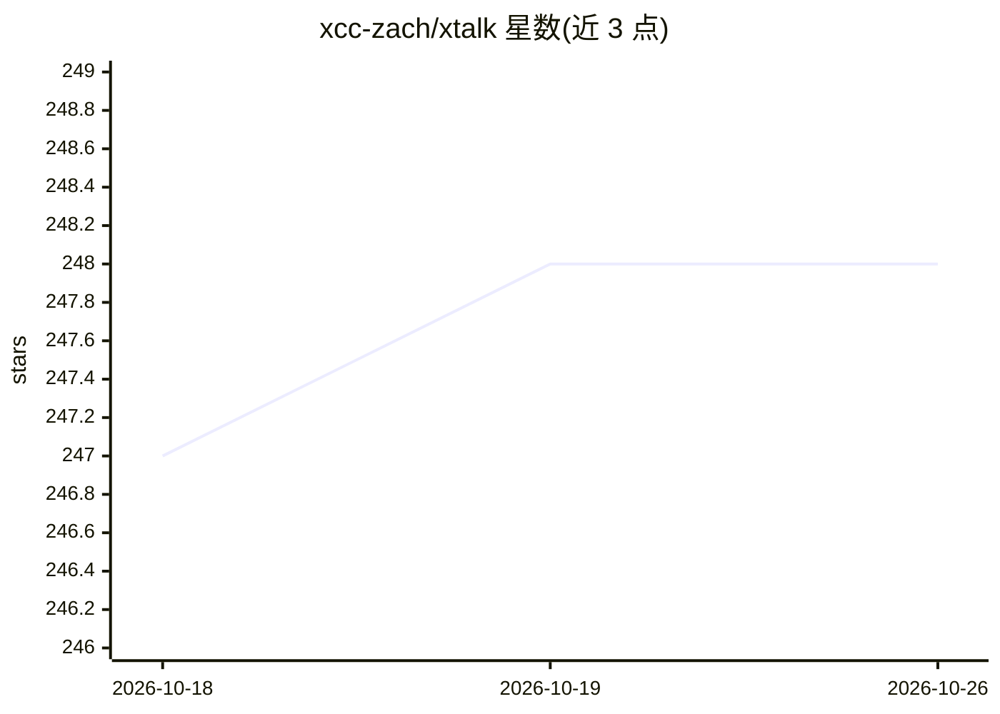

# xcc-zach/xtalk

⭐ 248 · Python · NOASSERTION · 推送 2026-10-21 · [GitHub](https://github.com/xcc-zach/xtalk) · [官网](https://xtalk.sjtuxlance.com) · 个人维护

**开源全双工级联语音对话系统框架：低延迟可打断的人机语音交互**

纯 Python 实现的全双工级联语音对话系统框架：优化语音流以支持低延迟，允许用户自然打断，并在语音之外并行编码副语言信息（噪声、情绪）；新模型与逻辑可在单个 Python 脚本内接入并接入默认流水线。后端异步支持并发，基于 WebSocket 实现从浏览器到边缘设备的部署。安装仅需 pip，Quickstart 演示用阿里云 API（ASR/LLM），也支持本地部署模型（如 vLLM）。README 声明处于活跃原型期，接口可能变动。

## 筛选速览

| 维度 | 判定 | 备注 |
|---|---|---|
| AI 角色 | `ai-ecosystem` | LLM/agent 周边工具 |
| 许可风险 | `none` | NOASSERTION |
| 部署形态 | `library` | 以包/库形式分发 |
| 模型依赖 | — | README 未给出锁定关系 |
| 硬件要求 | — | 无带数字的原话,不猜 |
| 安装摩擦 | `low` | 无编译、无系统依赖或容器化 |
| 成熟度 | `idea` | |

## 能力要点

- 全双工低延迟、可打断的语音交互流水线
- 并行编码副语言信息（环境噪声、情绪）
- 纯 Python 后端，pip 即装，新模型可单脚本接入
- 异步并发与 WebSocket 部署（浏览器到边缘设备）

## 适用场景

- 构建可实时打断的低延迟语音对话助手
- 在级联语音对话流水线中替换/接入自己的模型做研究
- 通过 WebSocket 把语音对话能力部署到网页或边缘设备

## 场景标签

`语音 Agent` · 领域:对话与助手

## 证据(README 行号)

> L15: X-Talk is an open-source full-duplex cascaded spoken dialogue system framework featuring:
> L21:  - **New models and relevant logic** can be added within one Python script, and seamlessly integrated with the defa

## 星数曲线

2026-10-18 247 → 2026-10-26 248（+1）

---
*卡片 v1 · prompt 1.4 · 生成 2026-10-22 · 置信度 high · 依据 README sha `3a6abfa4910a` · [字段定义](../../DATASET.md)*
