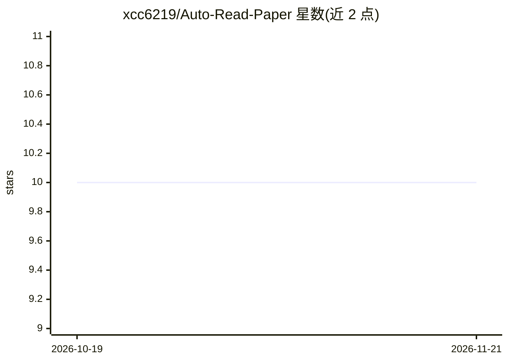

# xcc6219/Auto-Read-Paper

⭐ 10 · Python · AGPL-3.0 · 推送 2026-06-03 · [GitHub](https://github.com/xcc6219/Auto-Read-Paper) · 个人维护 · 中文 README

**每日自动抓取并精读 arXiv 论文、评分筛选后邮件推送的 AI 助手**

部署于 GitHub Actions 的个人论文阅读流水线：每日抓取 arXiv 新论文，经关键词预过滤后由 LLM 精读全文（TeX/HTML/PDF），生成三段式结构化摘要与双语标题，评分筛选后将邮件发送至用户邮箱。核心机制为 Reader + Reviewer 双 Agent 协作（逐篇结构化笔记 + 全局批量评分），配合 7 天滚动候选池记忆机制保留高分未发送论文。运行于 GitHub Actions，无需服务器；LLM 接入经 LiteLLM 统一，通过 OpenAI 兼容接口配置。

## 筛选速览

| 维度 | 判定 | 备注 |
|---|---|---|
| AI 角色 | `ai-native` | 本体是模型或模型工具 |
| 许可风险 | `viral` | AGPL-3.0 |
| 部署形态 | `None` |  |
| 模型依赖 | local-ok | 支持本地模型 |
| 硬件要求 | — | 无带数字的原话,不猜 |
| 安装摩擦 | `low` | 无编译、无系统依赖或容器化 |
| 成熟度 | — | 结构信号不足 |

## 能力要点

- Reader + Reviewer 双 Agent 流水线：单篇结构化笔记 + 全局批量校准评分（0-10）
- 自动深读全文（TeX/HTML/PDF），生成配置语言的三段式结构化摘要
- 7 天滚动候选池记忆，高分未发送论文跨日重赛
- 外部 cron 调度规避 GitHub 60 天闲置暂停机制

## 适用场景

- 每天定时收到精选 AI 论文的邮件摘要
- 让 AI 替我筛选与精读 arXiv 最新论文
- 以中文或指定语言获取英文论文的结构化解读

## 场景标签

`多智能体` `科研工具` · 领域:Agent 开发

## 证据(README 行号)

> L11:  Your personal AI paper-reading assistant — automatically fetches fresh arXiv papers daily, runs a multi-agent read
> L22: Unlike the common "score each paper in isolation" approach, Auto-Read-Paper ships with a **Reader + Reviewer two-ag
> L112: |`LLM_API_KEY`|**Unified** API key for your LLM provider — OpenAI, Anthropic, Gemini, DeepSeek, Qwen, Kimi, MiniMa

## 星数曲线

2026-10-19 10 → 2026-11-21 10（+0）

---
*卡片 v1 · prompt 1.4 · 生成 2026-11-19 · 置信度 high · 依据 README sha `72b761aba958` · [字段定义](../../DATASET.md)*
